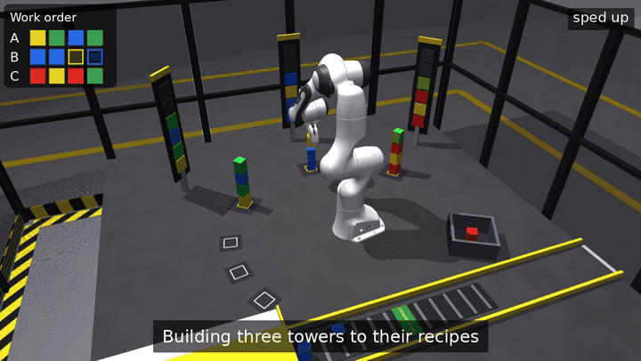
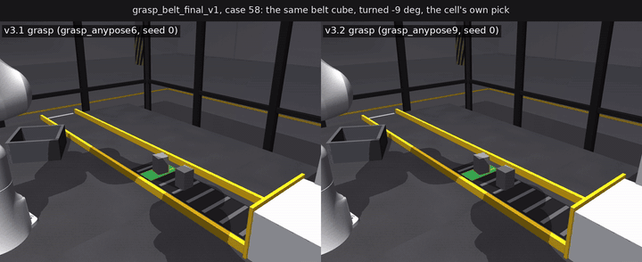
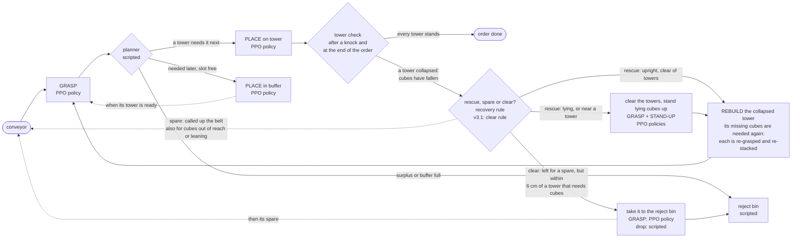

# PolyPanda

Reinforcement learned manipulation skills for a simulated Franka Panda in MuJoCo: from picking and placing one cube, to building towers to work orders in a small production cell, to noticing when a tower is knocked over and rebuilding it. Every learned skill is measured on held-out sets, next to a scripted baseline on the same cases, every target is committed before the work it measures, and every result is reproducible from a clean commit.



*v3 (`scripts/record_recovery.py`): tower B is knocked flat the moment it is complete. The cell notices, moves the fallen cubes clear of the other towers, stands the lying ones upright and rebuilds the tower. Grasping, standing up and stacking are PPO policies; the recovery decisions shown in the robot's log, the swings between stations and the drop into the reject bin are scripted. The knock was chosen for the demo; everything after it is the cell's own. One cube landed leaning, which the grasp is not trusted with, so it is left alone and a blue cube from the belt takes its place. [Full video](https://github.com/Abdullah-Muz/polypanda/releases) · the v2 cell: [workcell.gif](docs/figures/workcell.gif).*

> **Status:** v3.2. Milestones 1–11 complete: v3 adds recovery from knocked-over towers, two new learned skills and a learned recovery planner; v3.1 retrains both skills to their targets and tests a clutter-clearing recovery rule, which did not beat the best rule. v3.2 is released: its grasp target was not met, but the cell adopts the new grasp, and in the final cell run it completes significantly more orders than v3.1's (91.5 against 85.7 %). v4.0 (machine tending) is in progress: its learned door opens and closes 99.6 % of 400 machines it has never seen, 3.6× faster than a well-written feel script, though less gently ([results](docs/results.md#v40-a-learned-door-for-machines-it-has-not-seen)). Simulation only: nothing here has been run on a real robot.

## Results

Held-out sets that training never touched, 95 % Wilson intervals, learned policies pooled over 3 seeds and compared with the scripted baseline case by case (exact McNemar tests). Full tables: [docs/recovery.md](docs/recovery.md), [docs/results.md](docs/results.md), [docs/workcell.md](docs/workcell.md), [docs/cartesian_actions.md](docs/cartesian_actions.md).

**v3.2** (new held-out sets that run the grasp through the cell's own pick, one upright cube per case, every seed judged separately). One grasp round aimed at seed 0's knock-overs. Its last allowed round, `grasp_anypose9`, missed seed 0's floor bar on the development sets, so **the v3.2 grasp target is not met**. The cell uses it from v3.2 on all the same: a post-hoc decision, made after the development results. The one-shot sets were then run once on it:

| v3.2, `grasp_anypose9`, per seed 0 / 1 / 2 | Result | Bar |
|---|---|---|
| Upright cube on the belt, turned up to ±15° | **100 / 100 / 100 %**, none knocked over (v3.1 97.5 / 100 / 100 %, 5 knocked over; p = 0.063) | ≥ 99 %, ≤ 1 knocked over: met |
| Upright cube on the floor near the base, turned −45..+45° | **94.5** / 100 / 100 %; seed 0's −45..−35° bin 14/23 (v3.1 89.5 / 100 / 100 %, p = 0.021; scripted 100 %) | ≥ 95 %, no 10° bin under 85 %: **missed** (seed 0) |
| The same floor cases, size ×0.85–1.15 | 94.0 / 100 / 100 %, gap −0.2 points (v3.1 81.5 / 99.5 / 99.0 %, p = 4e-6) | within 5 points: met |
| Lying cubes, v3.1's one-shot set | **98.3 %** (v3.1 97.8 %, p = 0.65) | no significant drop: met |
| The final cell run, all orders: the v3.2 cell against the v3.1 cell (held-out suite of 200 orders) | **91.5 %** against 85.7 % (47 / 12, p = 5e-6); seed 0 89.5 against 71.0 %, seeds 1–2 level | significantly more (p < 0.05): **met** |
| Recoverable knocks without spares, D1 / D2 / D3 | 96.2 / 95.8 / 92.3 % | 90 / 85 / 80 %: met |
| Orders with no knock | v3.2 cell **99.3 %** (v3.1 cell 92.0 %); without spares 98.7 % | 99 %: **missed** without spares (one order short) |

The belt is fixed on every seed. Seed 0 still fails on standing cubes near the base turned close to −45°, where the scripted pick does not. The stand-up was not retrained, so the v3.2 cell pairs v3.1's stand-up with a grasp it was not trained after. [results.md](docs/results.md#v32-a-grasp-round-for-the-cells-picks), [v3_2_targets.md](docs/v3_2_targets.md).



*v3.2 (`scripts/record_pick_compare.py`): the same staged belt cube, picked by the cell's own pick with v3.1's grasp (left) and v3.2's (right), seed 0. Cases 58 and 190 of the one-shot belt set `grasp_belt_final_v1`, chosen to show the difference: they are 2 of the 5 cubes (of 200) v3.1's seed 0 knocked over there; v3.2 knocked over none. Both grasps are PPO policies. [Full video](https://github.com/Abdullah-Muz/polypanda/releases).*

**v3.1** (Milestone 11; fresh one-shot sets and a new held-out suite of 200 orders, 3 seeds). Both recovery skills were retrained with a randomized cube size, and a hand-written rule that clears clutter was tested against the best rule:

| v3.1 | Result | Target |
|---|---|---|
| Grasp a cube lying on its side (PPO) | **97.8 %** on a fresh one-shot set (v3.0 95.5 % on the same cases, p = 0.034; scripted 84.5 %); size varied 96.7 % | 85 %: **met** |
| Stand a held cube upright beside towers (PPO + turn chooser, shield, re-planning) | **90.0 %** (v3.0 88.2 %, p = 0.2; scripted 90.5 %, p = 0.81); size varied 88.3 % (v3.0 76.8 %) | 90 %: **met** |
| The cell with 2 spares and a deadline: clear rule against the best rule, knocked orders | **86.0 %** vs 86.5 % (p = 0.84): the clutter went, but more orders ran late | significantly better: **missed** |
| Recoverable knocks without spares, D1 / D2 / D3 | **90.6 / 89.2 / 89.8 %** (v3.0 cell on the same orders: 94.8 / 79.5 / 88.2 %) | 90 / 85 / 80 %: met |
| Orders with no knock | 95.4–96.3 % (v3.0 cell: 96.3 %), every miss on seed 0 | 99 %: **missed** |
| All orders, the v3.1 cell | **87.0 %** (v3.0 cell 81.5 %, scripted 82.0 %, no recovery 21.5 %) | |

Seed 0's new grasp knocks over upright cubes in the cell (2.0 % on the belt, 16 % on the floor), traced to the cube's rotation relative to the hand. Seeds 1 and 2 almost never do, and on them the v3.1 cell completes 93.5 % of all orders. [recovery.md](docs/recovery.md#v31-milestone-11-new-skills-and-clearing-clutter), [v3_2_candidates.md](docs/v3_2_candidates.md).

**Recovering from knocks** (Milestone 10, v3.0; 200 held-out orders, each with one knock or none, 3 seeds). The cell reads its towers as they stand, notices a knock and rebuilds with learned skills only: PPO grasp (now also of cubes lying on their side), PPO stand-up and PPO place. Knocks that no robot could recover (a cube out of reach or leaning on something; about a third of them) are run and reported, but the targets count the recoverable ones:

| Knock, recoverable orders completed | Target | **Learned skills** | Scripted skills |
|---|---|---|---|
| One cube falls (D1) | ≥ 90 % | **93.2 %** (218/234) | 96.2 % |
| Part of a tower falls (D2) | ≥ 85 % | **87.5 %** (28/32) | 8/8 |
| The whole tower falls (D3) | ≥ 80 % | **91.5 %** (75/82) | 86.7 % |
| All 200 orders, every knock | | 77.5 % | 78.5 % (paired p = 0.58) |

| New in v3 | Result |
|---|---|
| Grasp a cube lying on its side (PPO) | **84.8 %** on a one-shot set (target 85 %; scripted 84.0 %) |
| Stand a held cube upright beside towers (PPO + a learned turn chooser, a sliding safety shield, re-planning) | **87.7 %** on a one-shot set (target 90 %; scripted 93.0 %) |
| Learned recovery planner: rescue a fallen cube or call a spare, against a deadline | symbolic cell **94.3 %** vs the best of 32 hand-written rules 92.5 % (p < 1e-29); physics cell **86.2 %** vs 88.3 % (p = 0.08): a sim-to-physics gap, [explained](docs/recovery.md#the-planner-in-the-physics-cell-g-a-sim-to-physics-gap) |

**The work-order cell** (Milestone 9; 200 held-out orders per configuration, 3 towers of 1–4 cubes each). Grasp and place are PPO policies. The planner, the moves between stations, the descent to the stack, the finger gates, the IK and the grasp assist are scripted:

| Grasp and place | Layer 1: cubes arrive in a buildable order | Layer 2: random order, surplus cubes, 3-slot buffer |
|---|---|---|
| **Learned (PPO), stacking place v3 aimed at the fixture** | **599/600 orders = 99.8 %** (99.1–100 %) | **595/600 = 99.2 %** (98.1–99.6 %) |
| Learned (PPO), stacking place v1 | 599/600 | 587/600 = 97.8 % |
| Scripted (baseline) | 200/200 | 200/200 |

The learned grasp was trained once, on a plain table in front of the robot. It runs at the conveyor and the buffer through station frames, unchanged: 2010 of 2010 picks per seed in Layer 2. Every failed order is a 4-high tower that, in the cases replayed, crept out of tolerance in the simulator after a placement a few millimetres off.

**Pick-and-place** (Milestone 8; 200 held-out scenes: random cube pose, random target, from the home pose):

| System | Success | Time to placed |
|---|---|---|
| **Fully learned chain**: PPO grasp, transport and place; scripted supervisor | **88.5 %** (85.7–90.8 %); best seed 96.0 % | 7.5 s |
| v1.0 system: PPO grasp (joint actions), scripted transport and place | 89.0 % (paired p = 0.84) | |
| All scripted (baseline) | 100 % | 12.4 s |

**Each learned skill against its scripted baseline:**

| Skill | Learned (PPO, 3 seeds) | Scripted baseline |
|---|---|---|
| Reach and hold a 3-D target | **100 %**, 1.5 mm | IK 100 % |
| Grasp any cube pose, lift 5 cm (hand motion) | **91.3 %**; whole table 85.0 %; among other cubes 84.7 % | 100 % |
| Transport a held cube to a 3-D goal | **90.2 %** | 92.0 % (p = 0.16) |
| Stand a cube upright on a table target | 95.1 %; **99.5 %** inside pick-and-place | 97.5 %; 100 % |
| Set a cube on a tower or a buffer slot (in the cell, stacking v3) | **4543/4545** placements in Layer 1, **5369/5373** in Layer 2 | scripted cell: every order |

## What I learned

**In v3.1** ([recovery.md](docs/recovery.md#what-i-learned-v31)):

1. **Removing a mechanism is not the same as winning orders.** The clear rule took the clutter away from the towers, and failed places fell by 40 %. But failed places were mostly retried anyway, and clearing cost time, so completed orders did not move.
2. **Test a skill where it will run, seed by seed.** The new grasp met its one-shot target easily, yet one seed of three knocks over rotated upright cubes in the cell, a situation the one-shot set does not cover.
3. **Train on what the task varies.** Randomizing the cube size cut the stand-up's size loss from 14 points to 4, and cost the grasp nothing on lying cubes.

**In v3.0** ([recovery.md](docs/recovery.md#what-i-learned)):

1. **Measure the physical ceiling before setting a target.** About a third of knocks cannot be recovered by any robot: cubes land out of reach or leaning on each other. Targets over all knocks would have measured the dice, not the robot.
2. **Check for headroom before training a planner.** Twice, a search for the best possible decisions showed that hand-written rules were already near-optimal, first for routing and then for recovery. It changed what the planner was for, before any training was spent on it.
3. **Root causes were in the setup, not the algorithm.** The lying-cube grasp failed for three rounds because of observation statistics inherited from a warm start and a gripper too weak to hold a cube across its width. Neither was a reward or hyperparameter problem.
4. **Decompose a hard skill.** A stand-up policy that picked its own turn direction collapsed onto one direction and hit towers. A policy commanded which way to turn, a learned chooser for the command, a safety shield that slides the arm along obstacles and re-planning after stalls made it work.
5. **A simulator that matches the averages can still miss a mechanism.** The planner's symbolic cell reproduced every rate it was calibrated on, but not the clutter the planner's own choices left behind, and its edge vanished in physics.

**In v1 and v2:**

1. **The action interface mattered more than the reward.** PPO with joint increments never learned to carry a cube (0 %). With actions that move the hand, plus two fixes below, it carries at nearly the scripted level (90.2 % against 92.0 %), and the grasp improved most where the task was hardest. [cartesian_actions.md](docs/cartesian_actions.md)
2. **Look at what the policy does before changing the reward.** Learned transport went from 0 % to the scripted level through three diagnoses: the wrist spinning, a policy mean stuck outside the action bounds (fixed by an action bound penalty), and carrying too fast.
3. **Exploration, not reward, was the grasping bottleneck.** Plain PPO learned to close on the cube but never to lift it. Starting 30 % of training episodes with the cube already in hand fixed it. [grasp_task.md](docs/grasp_task.md)
4. **Episode design can teach the wrong skill.** Reach v1 ended episodes on success, so PPO learned to pass through targets (14.5 % held). Running every episode to the horizon with a hold reward fixed it. [reach_task.md](docs/reach_task.md)
5. **A shaping cost must stay smaller than the failure it guards against.** Three stacking-place attempts never learned: an unbounded cost after release made losing the cube the cheapest outcome. [workcell.md](docs/workcell.md#v3-reward-precision-as-well)
6. **A validation score covers the situation it was measured in.** In the cell, a deterministic place policy fed near-identical starts repeats the same 2–3 mm error. Aimed at the cube below, those errors added up into leaning towers (12 % of Layer 1 and 31 % of Layer 2 orders failed). Aimed at the fixture, the same policy became the best one: a fix in the supervisor, not in training. [workcell.md](docs/workcell.md#v3-in-the-cell-a-root-cause-analysis)
7. **Seeds and validation noise decide conclusions.** One configuration produced grasp policies from 66 % to 94 %, and 30-episode validation picked "luckiest", not "best". Everything here reports 3 seeds and validates on 100 episodes. [generalization.md](docs/generalization.md)
8. **Keep the scripted baseline honest and in view.** Learned policies interpolate; the IK grasp extrapolates (99 % just outside the training region against 58 %). For transport in Milestone 4, residual RL on the scripted carry changed nothing. [robustness.md](docs/robustness.md), [transport_task.md](docs/transport_task.md)

## How it works



*When a tower is knocked over, the cell rebuilds it. The knocked tower's missing cubes count as needed again, and each rescued cube (or its spare) goes back through the grasp and the planner like a new arrival, so the tower is stacked again in recipe order. The recovery rule is asked only when the order has spares left. Without spares, the cell rescues every cube it can, and an order with a cube it cannot rescue fails. v3.1's rule is v3.0's best rule with one change: a cube it would leave for a spare is first taken to the reject bin when it lies within 6 cm of a tower that still needs cubes, because cubes left there made later placements on that tower fail about 1 time in 5. It removed that clutter, but did not complete more orders (see Results).*

- **One environment per skill**, each with its own observations, success checks and gates. Skills trained in front of the robot run at any station through **station frames**: the scene is rotated into the frame the skill was trained in, and its hand motions are rotated back. [workcell.md](docs/workcell.md)
- **Transitions are verified predicates, never timers.** A grasp counts only with both fingers in contact and the cube lifted and not slipping. In pick-and-place, switching on timers instead costs 18 points. [pick_and_place.md](docs/pick_and_place.md)
- **Pick-and-place** runs under a finite-state-machine supervisor with verified handoffs, exact physics-state transfer between skill environments, and recovery (release, lift clear, return home, retry up to twice).
- **Closed loop (v3): knocked-over towers are rebuilt.** After a knock and at the end of every order, the cell reads which cubes stand on each tower and which have fallen, and how each rests. Fallen cubes near a tower are moved to a staging ring first, lying cubes are stood upright, and each is then picked and routed like a new arrival until the knocked tower is rebuilt; with spares, a recovery rule may call a replacement up the belt instead, and v3.1's clear rule first takes a cube left beside a tower to the reject bin. One cube, part of a tower or a whole tower can fall; the results table above shows how often each is rebuilt. [recovery.md](docs/recovery.md)
- **Disclosed simplification:** in the simulator a firmly held cube slides out of the fingers during long carries, whatever the grip settings. In the cell, a verified grip is therefore welded to the hand while carrying, for learned and scripted skills alike. [workcell.md](docs/workcell.md#grasp-assist-a-disclosed-simplification)

## Quickstart

Requires Linux (developed on Ubuntu 24.04 under WSL2), git and [uv](https://docs.astral.sh/uv/). No GPU needed.

```bash
git clone https://github.com/Abdullah-Muz/polypanda.git
cd polypanda
scripts/fetch_assets.sh                  # pinned MuJoCo Menagerie Panda model
uv sync                                  # Python 3.12 from uv.lock (CPU PyTorch)
uv run python scripts/verify_install.py  # versions, model contract, headless stepping
uv run pytest                            # test suite
scripts/fetch_models.sh                  # trained policies from the GitHub Release (checksummed)
```

Watch it (opens the MuJoCo viewer):

```bash
uv run python scripts/view_workcell.py --recover --jitter --pick run:runs/grasp_anypose6_seed1 \
    --place run:runs/place_stack_v3_seed1 --standup run:runs/standup_round12_seed1
    # v3: press K to knock the next tower, and watch the cell rebuild it (--auto-knock: one per order)
uv run python scripts/view_workcell.py --replay 15 --orders-seed 20261203 --recover \
    --disturbances eval_sets/disturbance_suite_v2.json --spares 2 --slack 1.5 \
    --recovery-planner clear-rule --pick run:runs/grasp_anypose6_seed1 \
    --place run:runs/place_stack_v3_seed1 --standup run:runs/standup_round12_seed1
    # replay any evaluated order exactly: here the v3.1 cell on a held-out order whose whole
    # tower falls; it clears one cube from beside a tower and finishes in time
uv run python scripts/view_workcell.py --mixed --jitter \
    --pick run:runs/grasp_cart_seed2 --place run:runs/place_stack_v3_seed2   # the cell, learned
uv run python scripts/view_workcell.py --mixed                              # the cell, scripted
uv run python scripts/demo_pickplace.py --grasp run:runs/grasp_v2yaw_seed1   # pick-and-place
```

Reproduce a headline number:

```bash
uv run python scripts/evaluate_cell.py --mixed --recover \
    --disturbances eval_sets/disturbance_suite_v2.json --seed 20261203 --n 200 \
    --pick run:runs/grasp_anypose6_seed1 --place run:runs/place_stack_v3_seed1 \
    --standup run:runs/standup_round12_seed1 \
    --spares 2 --slack 1.5 --recovery-planner clear-rule        # the v3.1 cell, one seed
uv run python scripts/evaluate_cell.py --mixed --recover \
    --disturbances eval_sets/disturbance_suite_v1.json --pick run:runs/grasp_anypose5_seed1 \
    --place run:runs/place_stack_v3_seed1 --standup run:runs/standup_round11_seed1  # v3.0 recovery, one seed
uv run python scripts/evaluate_recovery_planner.py runs/recovery_planner_seed{0,1,2}   # v3 planner, symbolic
uv run python scripts/evaluate_cell.py --mixed \
    --pick run:runs/grasp_cart_seed1 --place run:runs/place_stack_v3_seed1  # Layer 2, one seed
uv run python scripts/evaluate_pickplace.py --grasp run:runs/grasp_cart_seed1 \
    --transport run:runs/transport_slow_seed1 --place run:runs/place_cart_seed1  # learned chain
uv run python scripts/diagnose_cell_order.py --pick run:runs/grasp_cart_seed1 \
    --place run:runs/place_stack_v3_seed1 --mixed --index 59 --watch A  # replay one order
uv run python scripts/train.py --config configs/place_stack_v3_cartesian_ppo.yaml --seed 0
```

Every result file in [`results/`](results/) records the git commit (and whether the tree was clean), package versions and the evaluation set's digest.

## How it is built

| Layer | Contents |
|---|---|
| Simulation | MuJoCo 3.16; Panda from [MuJoCo Menagerie](https://github.com/google-deepmind/mujoco_menagerie) at a pinned commit, never modified (scenes are composed in memory with `MjSpec`) |
| Control | position servos at 20 Hz; actions are joint increments or hand motions turned into joint targets by damped least-squares IK |
| Environments | Gymnasium envs per skill with versioned observation and action schemas, verified success predicates and gated finger actuation |
| Learning | Stable-Baselines3 PPO (and SAC for comparison) on CPU PyTorch; YAML configs; best checkpoint selected on a separate validation stream; warm starts with function-preserving input renormalization; a 5-network turn chooser trained on the stand-up policy's outcomes |
| Supervision | finite-state machine for pick-and-place; greedy planner, station frames and scripted moves for the cell; a cell observer, closed-loop recovery, spares, and a symbolic cell calibrated on 18,000 logged skill attempts for the learned recovery planner |
| Evaluation | versioned held-out sets from dedicated random streams; Wilson intervals; exact McNemar tests; per-stage failure labels; a replay tool that logs and films any evaluation order |
| Engineering | `uv.lock`; Ruff; pytest; GitHub Actions CI; run metadata with git commit and schema checks on load |

| Docs | |
|---|---|
| [recovery.md](docs/recovery.md) | v3: knocks and the physical ceiling, the lying-cube grasp and the stand-up, learned recovery, the symbolic cell, headroom gates, the learned recovery planner and its sim-to-physics gap; v3.1: the retrained skills, the clear rule and seed 0's grasp in the cell |
| [v3_targets.md](docs/v3_targets.md), [v3_1_targets.md](docs/v3_1_targets.md), [v3_2_targets.md](docs/v3_2_targets.md) | v3, v3.1 and v3.2 targets as committed before the work, with dated amendments and every result as it came |
| [v3_2_candidates.md](docs/v3_2_candidates.md) | the proposal behind v3.2, from the v3.1 diagnoses: grasp fixes and a cell-like pick check |
| [v4_plan.md](docs/v4_plan.md), [machine_tending_candidates.md](docs/machine_tending_candidates.md) | the v4.0 plan (a learned machine-tending skill for machines it has not seen, trained from demonstrations, then RL) and the candidates doc it builds on |
| [v4_targets.md](docs/v4_targets.md), [door_env.md](docs/door_env.md) | v4.0 targets as committed before training, every rule change and result as it came, and the lock; the door skill's environment |
| [pose_error.md](docs/pose_error.md) | v4 sensing: how far off a simple simulated depth-camera estimate of a cube's pose is (1–3 mm), and why that does not make the scripted place fail |
| [workcell.md](docs/workcell.md) | the work-order cell: grasp assist, station frames, buffer and planner, stacking place v1–v3, a root-cause analysis |
| [cartesian_actions.md](docs/cartesian_actions.md) | hand-motion actions and the fully learned pick-and-place chain |
| [generalization.md](docs/generalization.md) | wide-region and cluttered grasping, checkpoint selection |
| [reach_task.md](docs/reach_task.md), [grasp_task.md](docs/grasp_task.md), [transport_task.md](docs/transport_task.md), [place_task.md](docs/place_task.md) | each skill: task design, baselines, training, failure analysis |
| [pick_and_place.md](docs/pick_and_place.md), [robustness.md](docs/robustness.md) | supervisor, end-to-end evaluation, ablations, perturbation suite |
| [evaluation_protocol.md](docs/evaluation_protocol.md), [results.md](docs/results.md) | protocol and result tables |
| [model_cards.md](docs/model_cards.md) | every published policy, its scope and limitations; from v3.2 the cell's grasp is `grasp_anypose9` (v3.1: `grasp_anypose6`) |
| [environment.md](docs/environment.md), [control_design.md](docs/control_design.md) | simulator setup, action interfaces |

## Limitations

- **Simulation only.** No sim-to-real claim is made; the policies have never controlled hardware, and none uses vision. Observations include the cube's position relative to the hand.
- **Cubes only.** 4 × 4 × 6 cm cubes, the Panda's standard parallel gripper, an open table or the cell's fixed stations.
- **The cell is partly scripted.** Grasping, placing and standing cubes up are learned there. The rescue, replace or clear decision is a hand-written rule in v3.1, because the learned planner of v3.0 did not beat it in physics. Routing, the recovery order, moves between stations and rejection are scripted. The grasp assist means cell results do not measure grip retention.
- **v3's own misses.** In v3.0, both new skills fell just short of their targets; v3.1 retrained them to 97.8 % and 90.0 %. Recovery decisions are still not learned: the v3.0 planner beat the hand-written rules only in the symbolic cell, and v3.1's clear rule did not beat the best rule in physics. Orders with no knock complete 95–96 %, short of the 99 % bar. One of three seeds (seed 0) is clearly weaker in the cell: its grasp knocks over rotated upright cubes, in v3.0 and in v3.1. v3.2's grasp round fixed its belt picks, not its floor picks near −45°.
- **Simulator effects set the ceiling.** The gripper holds weakly in the simulator, and slightly offset stacks creep over minutes of simulated time. Every learned failure in the cell traced so far ends in that creep.
- **The scripted baselines are still ahead.** They reach 100 % in pick-and-place and in the cell; the learned skills come close but do not match them everywhere.

## Roadmap

| Milestone | Scope | Status |
|---|---|---|
| 1–3 | Reproducible environment; reaching task, IK baseline, PPO and SAC | Done ([environment](docs/environment.md), [reach](docs/reach_task.md)) |
| 4–6 | Grasp, transport and place skills, FSM supervisor, robustness, ablations; v1.0 release | Done ([pick-and-place](docs/pick_and_place.md), [results](docs/results.md)) |
| 7 | Generalizing the learned grasp to the whole table | Done, target not met with joint actions ([generalization](docs/generalization.md)) |
| 8 | Hand-motion actions; learned transport and place; fully learned chain | Done ([cartesian actions](docs/cartesian_actions.md)) |
| 9 | Work-order cell: conveyor, recipe towers, buffer and planner, learned grasp and place at every station | Layers 1–2 done (v2.0); Layer 3, towers of 5–6, later ([workcell](docs/workcell.md)) |
| 10 | Recovery from knocks: closed loop, lying-cube grasp, stand-up, learned recovery, symbolic cell, learned recovery planner | Done (v3.0); recovery targets met, two skill targets and the planner target missed ([recovery](docs/recovery.md)) |
| 11 | v3.1: another round for the two new skills (fresh one-shot sets, randomized cube size, real hand-off starts); a clutter-aware symbolic cell and a clearing rule | Done (v3.1); both skill targets met, the recovery target and the D0 bar missed ([recovery](docs/recovery.md#v31-milestone-11-new-skills-and-clearing-clutter)) |
| v3.2 | A grasp round aimed at the cell's knock-overs, with cell-like pick checks per seed; a final cell run on a new suite of 200 orders | Done (v3.2). Grasp target not met; `grasp_anypose9` adopted for the cell post hoc. Cell target met (91.5 against 85.7 %); the no-knock bar missed without spares by one order ([v3.2 targets](docs/v3_2_targets.md)) |
| v4.0 (Milestone 13) | Machine tending on a rail line: a learned door-and-load skill for machines it has not seen (v4.0), two operations with a flip (v4.1), a quality station (v4.2) | In progress. The learned door's one-shot result: 99.6 % on 400 unseen machines, 3.6× faster than the feel script; T1–T3 met, T4 missed on force ([results](docs/results.md#v40-a-learned-door-for-machines-it-has-not-seen), [v4 targets](docs/v4_targets.md)). Next: the door inside the line's tending cycle (T5) ([v4 plan](docs/v4_plan.md)) |
| Later | A symbolic cell where a failed skill costs time; cube positions from a camera | Proposed ([v3.2 candidates](docs/v3_2_candidates.md)) |

## Acknowledgements and references

- E. Todorov, T. Erez, Y. Tassa. *MuJoCo: A physics engine for model-based control.* IROS 2012.
- K. Zakka, Y. Tassa, MuJoCo Menagerie contributors. *MuJoCo Menagerie: A collection of high-quality simulation models for MuJoCo.* 2022. The Franka Emika Panda model (Apache-2.0) is downloaded at a pinned commit and not redistributed here.
- A. Raffin et al. *Stable-Baselines3: Reliable Reinforcement Learning Implementations.* JMLR 22(268), 2021.
- M. Towers et al. *Gymnasium: A Standard Interface for Reinforcement Learning Environments.* 2024.
- J. Schulman et al. *Proximal Policy Optimization Algorithms.* arXiv:1707.06347, 2017.
- T. Haarnoja et al. *Soft Actor-Critic Algorithms and Applications.* arXiv:1812.05905, 2018.

## License

MIT, see [LICENSE](LICENSE).
