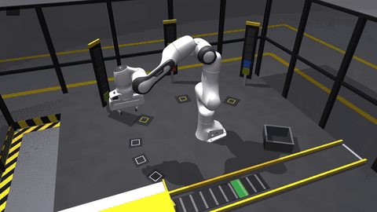
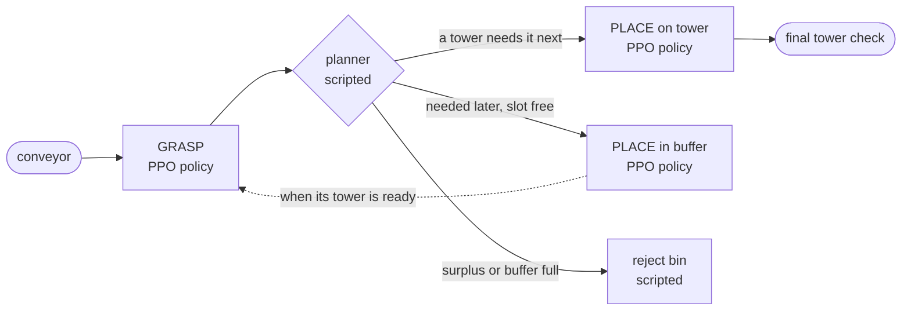

# PolyPanda

Reinforcement-learned manipulation skills for a simulated Franka Panda in MuJoCo: from picking and placing one cube to building towers to work orders in a small production cell. Every learned skill is measured on held-out sets, next to a scripted baseline on the same cases, and every result is reproducible from a clean commit.



*A Layer 2 work order (`scripts/record_cell.py`). Cubes arrive on the conveyor in random order, including one no tower needs. A PPO grasp policy picks each cube, and a PPO place policy sets it on a tower or parks it in a buffer slot until its tower is ready. The planner, the swings between stations and the drop into the reject bin are scripted. [Full video](https://github.com/Abdullah-Muz/polypanda/releases).*

> **Status:** v2.0. Milestones 1–8 complete; Milestone 9, the work-order cell, has Layers 1 and 2 done. Simulation only: nothing here has been run on a real robot.

## Results

Held-out sets that training never touched, 95 % Wilson intervals, learned policies pooled over 3 seeds and compared with the scripted baseline case by case (exact McNemar tests). Full tables: [docs/results.md](docs/results.md), [docs/workcell.md](docs/workcell.md), [docs/cartesian_actions.md](docs/cartesian_actions.md).

**The work-order cell** (Milestone 9; 200 held-out orders per configuration, 3 towers of 1–4 cubes each). Grasp and place are PPO policies. The planner, the moves between stations, the descent to the stack, the finger gates, the IK and the grasp assist are scripted:

| Grasp and place | Layer 1: cubes arrive in a buildable order | Layer 2: random order, surplus cubes, 3-slot buffer |
|---|---|---|
| **Learned (PPO), stacking place v3 aimed at the fixture** | **599/600 orders = 99.8 %** (99.1–100 %) | **595/600 = 99.2 %** (98.1–99.6 %) |
| Learned (PPO), stacking place v1 | 599/600 | 587/600 = 97.8 % |
| Scripted (baseline) | 200/200 | 200/200 |

The learned grasp was trained once, on a plain table in front of the robot. It runs at the conveyor and the buffer through station frames, unchanged: 2010 of 2010 picks per seed in Layer 2. Every failed order is a 4-high tower that, in the cases replayed, crept out of tolerance in the simulator after a placement a few millimetres off.

**Pick-and-place** (Milestone 8; 200 held-out scenes: random cube pose, random target, from the home pose):

| System | Success | Time to placed |
|---|---|---|
| **Fully learned chain**: PPO grasp, transport and place; scripted supervisor | **88.5 %** (85.7–90.8 %); best seed 96.0 % | 7.5 s |
| v1.0 system: PPO grasp (joint actions), scripted transport and place | 89.0 % (paired p = 0.84) | |
| All scripted (baseline) | 100 % | 12.4 s |

**Each learned skill against its scripted baseline:**

| Skill | Learned (PPO, 3 seeds) | Scripted baseline |
|---|---|---|
| Reach and hold a 3-D target | **100 %**, 1.5 mm | IK 100 % |
| Grasp any cube pose, lift 5 cm (hand motion) | **91.3 %**; whole table 85.0 %; among other cubes 84.7 % | 100 % |
| Transport a held cube to a 3-D goal | **90.2 %** | 92.0 % (p = 0.16) |
| Stand a cube upright on a table target | 95.1 %; **99.5 %** inside pick-and-place | 97.5 %; 100 % |
| Set a cube on a tower or a buffer slot (in the cell, stacking v3) | **4543/4545** placements in Layer 1, **5369/5373** in Layer 2 | scripted cell: every order |

## What I learned

1. **The action interface mattered more than the reward.** PPO with joint increments never learned to carry a cube (0 %). With actions that move the hand, plus two fixes below, it carries at nearly the scripted level (90.2 % against 92.0 %), and the grasp improved most where the task was hardest. [cartesian_actions.md](docs/cartesian_actions.md)
2. **Look at what the policy does before changing the reward.** Learned transport went from 0 % to the scripted level through three diagnoses: the wrist spinning, a policy mean stuck outside the action bounds (fixed by an action bound penalty), and carrying too fast.
3. **Exploration, not reward, was the grasping bottleneck.** Plain PPO learned to close on the cube but never to lift it. Starting 30 % of training episodes with the cube already in hand fixed it. [grasp_task.md](docs/grasp_task.md)
4. **Episode design can teach the wrong skill.** Reach v1 ended episodes on success, so PPO learned to pass through targets (14.5 % held). Running every episode to the horizon with a hold reward fixed it. [reach_task.md](docs/reach_task.md)
5. **A shaping cost must stay smaller than the failure it guards against.** Three stacking-place attempts never learned: an unbounded cost after release made losing the cube the cheapest outcome. [workcell.md](docs/workcell.md#v3-reward-precision-as-well)
6. **A validation score covers the situation it was measured in.** In the cell, a deterministic place policy fed near-identical starts repeats the same 2–3 mm error. Aimed at the cube below, those errors added up into leaning towers (12 % of Layer 1 and 31 % of Layer 2 orders failed). Aimed at the fixture, the same policy became the best one: a fix in the supervisor, not in training. [workcell.md](docs/workcell.md#v3-in-the-cell-a-root-cause-analysis)
7. **Seeds and validation noise decide conclusions.** One configuration produced grasp policies from 66 % to 94 %, and 30-episode validation picked "luckiest", not "best". Everything here reports 3 seeds and validates on 100 episodes. [generalization.md](docs/generalization.md)
8. **Keep the scripted baseline honest and in view.** Learned policies interpolate; the IK grasp extrapolates (99 % just outside the training region against 58 %). For transport in Milestone 4, residual RL on the scripted carry changed nothing. [robustness.md](docs/robustness.md), [transport_task.md](docs/transport_task.md)

## How it works



- **One environment per skill**, each with its own observations, success checks and gates. Skills trained in front of the robot run at any station through **station frames**: the scene is rotated into the frame the skill was trained in, and its hand motions are rotated back. [workcell.md](docs/workcell.md)
- **Transitions are verified predicates, never timers.** A grasp counts only with both fingers in contact and the cube lifted and not slipping. In pick-and-place, switching on timers instead costs 18 points. [pick_and_place.md](docs/pick_and_place.md)
- **Pick-and-place** runs under a finite-state-machine supervisor with verified handoffs, exact physics-state transfer between skill environments, and recovery (release, lift clear, return home, retry up to twice).
- **Disclosed simplification:** in the simulator a firmly held cube slides out of the fingers during long carries, whatever the grip settings. In the cell, a verified grip is therefore welded to the hand while carrying, for learned and scripted skills alike. [workcell.md](docs/workcell.md#grasp-assist-a-disclosed-simplification)

## Quickstart

Requires Linux (developed on Ubuntu 24.04 under WSL2), git and [uv](https://docs.astral.sh/uv/). No GPU needed.

```bash
git clone https://github.com/Abdullah-Muz/polypanda.git
cd polypanda
scripts/fetch_assets.sh                  # pinned MuJoCo Menagerie Panda model
uv sync                                  # Python 3.12 from uv.lock (CPU PyTorch)
uv run python scripts/verify_install.py  # versions, model contract, headless stepping
uv run pytest                            # test suite
scripts/fetch_models.sh                  # trained policies from the GitHub Release (checksummed)
```

Watch it (opens the MuJoCo viewer):

```bash
uv run python scripts/view_workcell.py --mixed --jitter \
    --pick run:runs/grasp_cart_seed2 --place run:runs/place_stack_v3_seed2   # the cell, learned
uv run python scripts/view_workcell.py --mixed                              # the cell, scripted
uv run python scripts/demo_pickplace.py --grasp run:runs/grasp_v2yaw_seed1   # pick-and-place
```

Reproduce a headline number:

```bash
uv run python scripts/evaluate_cell.py --mixed \
    --pick run:runs/grasp_cart_seed1 --place run:runs/place_stack_v3_seed1  # Layer 2, one seed
uv run python scripts/evaluate_pickplace.py --grasp run:runs/grasp_cart_seed1 \
    --transport run:runs/transport_slow_seed1 --place run:runs/place_cart_seed1  # learned chain
uv run python scripts/diagnose_cell_order.py --pick run:runs/grasp_cart_seed1 \
    --place run:runs/place_stack_v3_seed1 --mixed --index 59 --watch A  # replay one order
uv run python scripts/train.py --config configs/place_stack_v3_cartesian_ppo.yaml --seed 0
```

Every result file in [`results/`](results/) records the git commit (and whether the tree was clean), package versions and the evaluation set's digest.

## How it is built

| Layer | Contents |
|---|---|
| Simulation | MuJoCo 3.16; Panda from [MuJoCo Menagerie](https://github.com/google-deepmind/mujoco_menagerie) at a pinned commit, never modified (scenes are composed in memory with `MjSpec`) |
| Control | position servos at 20 Hz; actions are joint increments or hand motions turned into joint targets by damped least-squares IK |
| Environments | Gymnasium envs per skill with versioned observation and action schemas, verified success predicates and gated finger actuation |
| Learning | Stable-Baselines3 PPO (and SAC for comparison) on CPU PyTorch; YAML configs; best checkpoint selected on a separate validation stream |
| Supervision | finite-state machine for pick-and-place; greedy planner, station frames and scripted moves for the cell |
| Evaluation | versioned held-out sets from dedicated random streams; Wilson intervals; exact McNemar tests; per-stage failure labels; a replay tool that logs and films any evaluation order |
| Engineering | `uv.lock`; Ruff; pytest; GitHub Actions CI; run metadata with git commit and schema checks on load |

| Docs | |
|---|---|
| [workcell.md](docs/workcell.md) | the work-order cell: grasp assist, station frames, buffer and planner, stacking place v1–v3, a root-cause analysis |
| [cartesian_actions.md](docs/cartesian_actions.md) | hand-motion actions and the fully learned pick-and-place chain |
| [generalization.md](docs/generalization.md) | wide-region and cluttered grasping, checkpoint selection |
| [reach_task.md](docs/reach_task.md), [grasp_task.md](docs/grasp_task.md), [transport_task.md](docs/transport_task.md), [place_task.md](docs/place_task.md) | each skill: task design, baselines, training, failure analysis |
| [pick_and_place.md](docs/pick_and_place.md), [robustness.md](docs/robustness.md) | supervisor, end-to-end evaluation, ablations, perturbation suite |
| [evaluation_protocol.md](docs/evaluation_protocol.md), [results.md](docs/results.md) | protocol and result tables |
| [model_cards.md](docs/model_cards.md) | every published policy, its scope and limitations |
| [environment.md](docs/environment.md), [control_design.md](docs/control_design.md) | simulator setup, action interfaces |

## Limitations

- **Simulation only.** No sim-to-real claim is made; the policies have never controlled hardware, and none uses vision. Observations include the cube's position relative to the hand.
- **Cubes only.** 4 × 4 × 6 cm cubes, the Panda's standard parallel gripper, an open table or the cell's fixed stations.
- **The cell is partly scripted.** Only grasping and placing are learned there; planning, moves between stations and rejection are scripted. The grasp assist means cell results do not measure grip retention.
- **Simulator effects set the ceiling.** The gripper holds weakly in the simulator, and slightly offset stacks creep over minutes of simulated time. Every learned failure in the cell traced so far ends in that creep.
- **The scripted baselines are still ahead.** They reach 100 % in pick-and-place and in the cell; the learned skills come close but do not match them everywhere.

## Roadmap

| Milestone | Scope | Status |
|---|---|---|
| 1–3 | Reproducible environment; reaching task, IK baseline, PPO and SAC | Done ([environment](docs/environment.md), [reach](docs/reach_task.md)) |
| 4–6 | Grasp, transport and place skills, FSM supervisor, robustness, ablations; v1.0 release | Done ([pick-and-place](docs/pick_and_place.md), [results](docs/results.md)) |
| 7 | Generalizing the learned grasp to the whole table | Done, target not met with joint actions ([generalization](docs/generalization.md)) |
| 8 | Hand-motion actions; learned transport and place; fully learned chain | Done ([cartesian actions](docs/cartesian_actions.md)) |
| 9 | Work-order cell: conveyor, recipe towers, buffer and planner, learned grasp and place at every station | Layers 1–2 done (v2.0); Layer 3, towers of 5–6, later ([workcell](docs/workcell.md)) |

## Acknowledgements and references

- E. Todorov, T. Erez, Y. Tassa. *MuJoCo: A physics engine for model-based control.* IROS 2012.
- K. Zakka, Y. Tassa, MuJoCo Menagerie contributors. *MuJoCo Menagerie: A collection of high-quality simulation models for MuJoCo.* 2022. The Franka Emika Panda model (Apache-2.0) is downloaded at a pinned commit and not redistributed here.
- A. Raffin et al. *Stable-Baselines3: Reliable Reinforcement Learning Implementations.* JMLR 22(268), 2021.
- M. Towers et al. *Gymnasium: A Standard Interface for Reinforcement Learning Environments.* 2024.
- J. Schulman et al. *Proximal Policy Optimization Algorithms.* arXiv:1707.06347, 2017.
- T. Haarnoja et al. *Soft Actor-Critic Algorithms and Applications.* arXiv:1812.05905, 2018.

## License

MIT, see [LICENSE](LICENSE).
