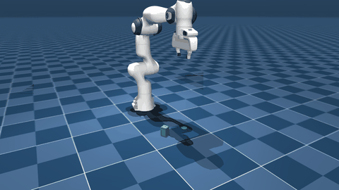
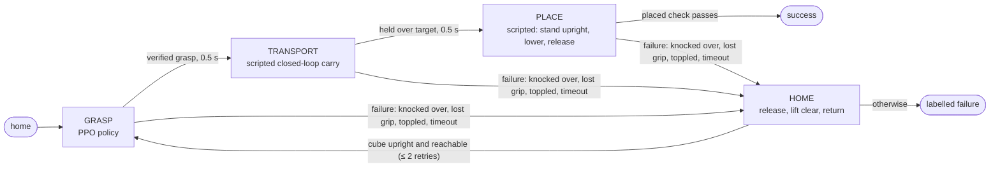

# PolyPanda

Autonomous pick-and-place with a simulated Franka Panda: reinforcement-learned and classical skills coordinated by a finite-state-machine supervisor, in MuJoCo, with every result measured on held-out sets and reproducible from a clean commit.



*From the home pose, the robot grasps a cube with a learned PPO policy, carries it, and stands it upright on the green target. Each stage is chosen by the supervisor and verified before the next starts (`scripts/record_demo.py`; [full video](https://github.com/Abdullah-Muz/polypanda/releases)).*

> **Status:** Milestones 1–8 complete (results below are from v1.0, Milestones 1–6). Milestone 9, a work-order cell, is in progress (Layers 1 and 2 done). Simulation only: nothing here has been run on a real robot.

## What it does



- **One environment per skill** (`GraspEnv`, `TransportEnv`, `PlaceEnv`), so each skill sees exactly the observations, gates and success checks it was built and evaluated with. At every handoff the supervisor moves the **exact physics state** (`mj_getState`/`mj_setState`) to the next skill's environment.
- **Transitions are verified predicates, never timers**: a grasp counts only with both fingers in contact, the cube lifted and not slipping. A placement counts only when the cube rests upright within 2 cm of the target, is still and is released. Switching on fixed timers instead costs 18 points (see the ablations below).
- **Each skill was chosen by evaluation, not assumption.** Learned PPO policies won at reaching and grasping. For transport and place, carefully designed scripted controllers were as good or better than RL, which was tried and documented.

## Results

All numbers come from held-out sets that training never touched, with 95 % Wilson intervals; learned policies are pooled over 3 seeds. Full tables: [docs/results.md](docs/results.md).

**Full pick-and-place** (200 scenes: random cube pose, random target ≥ 10 cm away, every episode from home):

| Grasp skill (transport and place scripted) | Success | First attempt | Time to verified placement (median) |
|---|---|---|---|
| Scripted grasp (IK from the true cube pose) | **100 %** (98.1–100 %) | 97.5 % | 12.4 s |
| **PPO grasp v2** (learned, from observations) | **89.2 %** (86.4–91.4 %) | 83.3 % | 9.8 s |
| PPO grasp v1 | 86.0 % (83.0–88.5 %) | 78.3 % | 9.5 s |

**Skills on their own:**

| Skill | Learned | Classical baseline |
|---|---|---|
| Reach (hold the tool point within 2 cm of a target) | PPO **100 %**, 1.5 mm; SAC 63.2 % | Jacobian IK 100 %, < 0.001 mm |
| Grasp (any cube pose, lift ≥ 5 cm with a verified grasp) | PPO v2 **87.0 %**, 4.4 s | scripted 100 %, 7.0 s |
| Transport (carry a held cube to a 3-D goal) | PPO 0 %; residual PPO 92.5 % (no gain) | **closed-loop carry 92.0 %** |
| Place (stand the cube upright on a target) | not needed | **scripted with upright correction 97.5 %** |

**Supervisor ablations** (same 200 scenes, PPO grasp v2):

| Full system | No retries | Timed switching instead of verified handoffs | No upright correction |
|---|---|---|---|
| **89.2 %** | 83.3 % | 71.2 % | 81.5 % |

**Robustness** (no training on any of these; [details and plot](docs/robustness.md)):

| Condition | Scripted grasp | PPO grasp v2 |
|---|---|---|
| Cube mass × 0.5–2 | 84.5 % | 74.3 % |
| Contact friction × 0.5–1.5 | 88.5 % | 79.7 % |
| Cube size ± 15 % | 99.5 % | 89.2 % |
| Arm start pose ± 0.1 rad per joint | 100 % | 86.5 % |
| Push of 0–2 N during transport | 66.0 % | 64.8 % |
| Cube outside the training region | 99.0 % | 58.0 % |

## What I learned

1. **Episode design can teach the wrong skill.** Reach v1 ended episodes on success, so PPO learned to pass through targets (14.5 % held). Running every episode to the horizon with a hold reward fixed it (100 %). [reach_task.md](docs/reach_task.md)
2. **Exploration, not reward, was the grasping bottleneck.** Plain PPO learned to close on the cube but never to lift it (0 %). Starting 30 % of *training* episodes with the cube already in hand ("reset to helpful states") produced 80.5 % from home. [grasp_task.md](docs/grasp_task.md)
3. **Diagnose before changing things.** The v1 grasp failed at 45° because two grasps were equally good. Fixing only that tie gave 87.0 % (p = 0.002). An earlier version that also penalized pushing the cube collapsed to 4–26 %: it learned to hover just short of touching. [grasp_task.md](docs/grasp_task.md#task-v2-milestone-62)
4. **RL is not always the right tool.** For transport, plain PPO never learned to carry (0 %), and learned residual corrections on the scripted carry changed nothing (the same 14 failures). The remaining failures came from grasp quality, not from the carry. [transport_task.md](docs/transport_task.md)
5. **Physics sets the ceiling.** The Panda gripper squeezes with about 1 N per finger, so cubes pivot in the hand. A cube released tilted more than 34° falls over, which is why the place skill first stands it upright (90.4 % → 97.5 %). Heavy or slippery cubes and pushes above about 1 N slip out whatever the grasp. [place_task.md](docs/place_task.md), [robustness.md](docs/robustness.md)
6. **Learned policies interpolate; planners extrapolate.** Inside its training region the PPO grasp handles physical variation reasonably well. Just outside it, success falls to 58 %, while the IK grasp stays at 99 %.

Other measured engineering lessons:
- three PPO runs in parallel were 9× slower until PyTorch was limited to one thread each;
- a recovery bug knocked cubes over on the way home;
- SAC's entropy collapse.

All three are written up where they happened.

## Quickstart

Requires Linux (developed on Ubuntu 24.04 under WSL2), git and [uv](https://docs.astral.sh/uv/). No GPU needed.

```bash
git clone https://github.com/Abdullah-Muz/polypanda.git
cd polypanda
scripts/fetch_assets.sh                  # pinned MuJoCo Menagerie Panda model
uv sync                                  # Python 3.12 from uv.lock (CPU PyTorch)
uv run python scripts/verify_install.py  # versions, model contract, headless stepping
uv run pytest                            # test suite
scripts/fetch_models.sh                  # trained policies from the GitHub Release (checksummed)
```

Watch it (opens the MuJoCo viewer):

```bash
uv run python scripts/demo_pickplace.py --grasp run:runs/grasp_v2yaw_seed1   # learned grasp
uv run python scripts/demo_pickplace.py                                      # all scripted
uv run python scripts/demo_grasp.py --policy run:runs/grasp_v2yaw_seed2      # grasp skill only
```

Reproduce a headline number:

```bash
uv run python scripts/evaluate_pickplace.py --grasp run:runs/grasp_v2yaw_seed1  # end to end
uv run python scripts/evaluate_grasp.py --policy run:runs/grasp_v2yaw_seed1     # grasp skill
uv run python scripts/evaluate_robustness.py --grasp scripted                   # robustness suite
uv run python scripts/evaluate_ablations.py --grasp scripted                    # ablations
uv run python scripts/train.py --config configs/grasp_v2_yaw_ppo.yaml --seed 0  # retrain (~40 min)
```

Every result file in [`results/`](results/) records the git commit (and whether the tree was clean), package versions and the evaluation set's digest.

## How it is built

| Layer | Contents |
|---|---|
| Simulation | MuJoCo 3.16; Panda from [MuJoCo Menagerie](https://github.com/google-deepmind/mujoco_menagerie) at a pinned commit, never modified (scenes are composed in memory with `MjSpec`) |
| Control | 7-D joint-increment actions on the Panda's position servos (20 Hz); damped-least-squares Jacobian IK for the classical baselines |
| Environments | Gymnasium envs per skill with versioned observation schemas, verified success predicates and gated finger actuation |
| Learning | Stable-Baselines3 PPO and SAC on CPU PyTorch; YAML configs; TensorBoard logs; best checkpoint selected on a separate validation stream |
| Evaluation | versioned held-out sets drawn from dedicated random streams; Wilson intervals; exact McNemar tests for paired comparisons; per-stage failure labels |
| Engineering | `uv.lock`; Ruff; pytest; GitHub Actions CI; run metadata with git commit and schema checks on load |

| Docs | |
|---|---|
| [environment.md](docs/environment.md) | simulator setup, model contract |
| [control_design.md](docs/control_design.md) | action interface and servo behaviour |
| [reach_task.md](docs/reach_task.md), [grasp_task.md](docs/grasp_task.md), [transport_task.md](docs/transport_task.md), [place_task.md](docs/place_task.md) | each skill: task design, baselines, training, failure analysis |
| [pick_and_place.md](docs/pick_and_place.md) | supervisor, end-to-end evaluation, ablations |
| [robustness.md](docs/robustness.md) | perturbation suite |
| [evaluation_protocol.md](docs/evaluation_protocol.md), [results.md](docs/results.md) | protocol and every result table |
| [model_cards.md](docs/model_cards.md) | the published policies, their scope and limitations |
| [workcell.md](docs/workcell.md) | the Milestone 9 work-order cell: grasp assist, station frames, buffer and planner, stacking place v1–v3 and a root-cause analysis (in progress) |

## Limitations

- **Simulation only.** No sim-to-real claim is made; the policies have never controlled hardware.
- **One object, one gripper.** A 4 × 4 × 6 cm cube on an open table, no obstacles or clutter, the Panda's standard parallel gripper.
- **The scripted skills use privileged state** (the true cube pose); the learned grasp uses its observation vector, which includes the cube's position relative to the hand. Neither uses vision.
- **The learned grasp is narrow.** It is trained on a 30 × 50 cm placement region and falls to 58 % just outside it. It remains well below the scripted grasp (89 % against 100 % end to end).
- **Grasp assist in the work-order cell (Milestone 9).** In the simulator, a firmly held cube slides along the finger pads whenever the arm moves, whatever the grip force or contact settings. So in the cell, a verified grip (both fingers pressing at least 2 N) welds the cube to the hand while it is carried, for learned and scripted skills alike. Grasping and releasing stay physical, and cell results do not measure grip retention. Details: [workcell.md](docs/workcell.md#grasp-assist-a-disclosed-simplification).

## Roadmap

| Milestone | Scope | Status |
|---|---|---|
| 1 | Reproducible environment, pinned Panda model, headless simulation, tests | Done ([details](docs/environment.md)) |
| 2 | Custom reaching environment and classical IK baseline | Done ([task](docs/reach_task.md)) |
| 3 | PPO and SAC reaching policies with benchmark | Done ([results](docs/results.md)) |
| 4 | Grasp and transport skills | Done ([grasp](docs/grasp_task.md), [transport](docs/transport_task.md)) |
| 5 | Place skill, FSM supervisor and full pick-and-place | Done ([place](docs/place_task.md), [pick-and-place](docs/pick_and_place.md)) |
| 6 | Robustness, grasp v2, ablations, model release, demo video | Done ([robustness](docs/robustness.md), [ablations](docs/pick_and_place.md#ablations-milestone-63-what-each-supervisor-design-choice-is-worth), [models](docs/model_cards.md)) |
| 7 | Generalizing the learned grasp to the whole table | Done, target not met ([generalization](docs/generalization.md)) |
| 8 | Hand-motion actions; learned transport and place; fully learned chain | Done ([cartesian actions](docs/cartesian_actions.md)) |
| 9 | Work-order cell: infeed conveyor, three recipe towers, learned skills at every station; random arrivals with a buffer and planner | In progress: Layers 1–2 done; learned grasp and place complete 99.8 % and 99.2 % of held-out orders ([workcell](docs/workcell.md)) |

## Acknowledgements and references

- E. Todorov, T. Erez, Y. Tassa. *MuJoCo: A physics engine for model-based control.* IROS 2012.
- K. Zakka, Y. Tassa, MuJoCo Menagerie contributors. *MuJoCo Menagerie: A collection of high-quality simulation models for MuJoCo.* 2022. The Franka Emika Panda model (Apache-2.0) is downloaded at a pinned commit and not redistributed here.
- A. Raffin et al. *Stable-Baselines3: Reliable Reinforcement Learning Implementations.* JMLR 22(268), 2021.
- M. Towers et al. *Gymnasium: A Standard Interface for Reinforcement Learning Environments.* 2024.
- J. Schulman et al. *Proximal Policy Optimization Algorithms.* arXiv:1707.06347, 2017.
- T. Haarnoja et al. *Soft Actor-Critic Algorithms and Applications.* arXiv:1812.05905, 2018.

## License

MIT, see [LICENSE](LICENSE).
