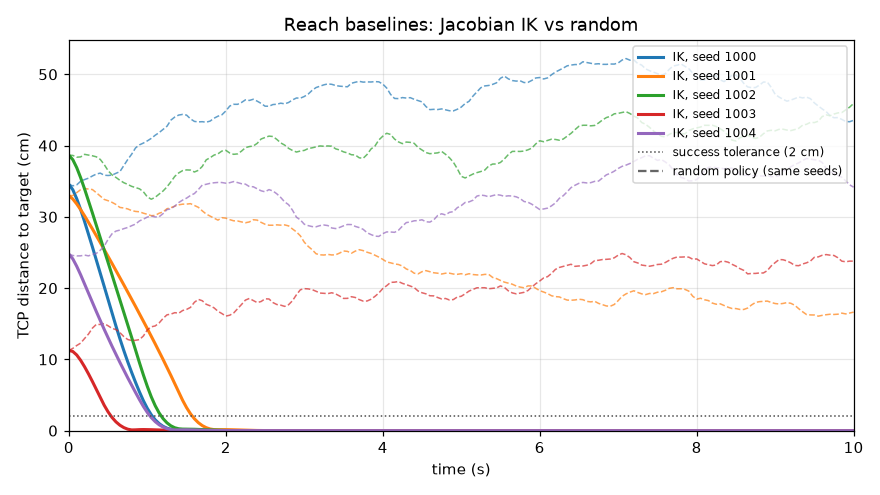
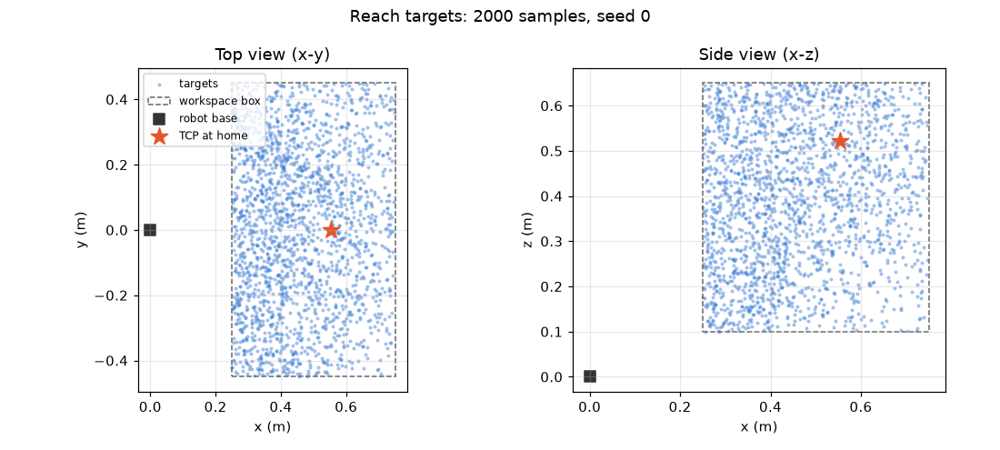

# Reach task definition

The reach skill moves the TCP (see [environment.md](environment.md#tool-centre-point-tcp)) to a 3-D target position. Orientation is not constrained in v1.

Environment: `polypanda.environments.reach.ReachEnv`, registered as `PolyPanda/Reach-v0`. Configuration is in `configs/reach.yaml`; unknown keys are rejected.

## Interface

**Action:** `Box(-1, 1, (7,), float32)`, sent through the joint-increment adapter ([control_design.md](control_design.md)) at 20 Hz.

**Observation:** schema `reach-v1-27d`, `float32`, world frame (the robot base is at the world origin):

| Slice | Content | Size |
|---|---|---:|
| 0–6 | joint positions `q` (rad) | 7 |
| 7–13 | joint velocities `dq` (rad/s) | 7 |
| 14–20 | commanded joint targets `q_cmd` (rad) | 7 |
| 21–23 | TCP position (m) | 3 |
| 24–26 | `target − TCP` (m) | 3 |

**Reset:** the arm starts at `home`, optionally with uniform joint noise (`start_joint_noise`). Targets are drawn by the sampler below, at least 0.10 m from the start TCP. `reset(options={"target": xyz})` injects a fixed target, which the evaluation set uses.

## Reward

Every term is returned separately in `info["reward_terms"]`.

| Term | Value | Purpose | Exploit risk |
|---|---|---|---|
| progress | `20 · (d_prev − d)` | Dense guidance | Telescopes to `20 · (d_start − d_end)`, so oscillating earns nothing |
| success | `+5` once | Reward finishing | Only paid for a physical success held through the dwell |
| action | `−0.005 · ‖a‖²` | Smooth, economical motion | If too large, standing still becomes optimal |
| contact | `−0.1` per step in contact | Avoid self and floor collisions | None obvious |
| joint_limit | `−0.01` per joint target at a bound | Avoid jamming into the stops | None obvious |
| non_finite | `−10`, then terminate | Numerical blow-up guard | Should never trigger |

Scale check: an efficient reach of 0.36 m earns about `+7 + 5 − 1.4 ≈ +11`. Standing still earns about 0, and a random policy about −2.7 (measured below). Success clearly dominates the do-nothing optimum.

## Termination

- **Success** (`terminated`): TCP within 0.02 m of the target for 5 consecutive policy steps (0.25 s). `info["is_success"]` is set, which SB3 uses for success-rate logging.
- **Time limit** (`truncated`): 200 policy steps (10 s). This is reported as truncation, not termination, so value targets bootstrap through timeouts instead of treating them as terminal states.
- **Non-finite state** (`terminated`): with `info["failure"] = "non_finite"`.

## Random-policy sanity baseline

30 episodes, seeds 0–29, uniform random actions:

| Metric | Value |
|---|---|
| Success | 0 / 30 |
| Return | −2.70 ± 1.50 |
| Mean distance, start → end | 0.378 m → 0.397 m |
| Mean reward terms per episode | progress −0.37, action −2.32, contact 0, joint_limit 0 |
| Single-process throughput | about 1,860 env steps/s (≈46,000 physics steps/s) |

SB3's `check_env` passes with no warnings.

## Validation (`tests/test_reach_validation.py`)

- **Random rollouts** (3 seeds, full horizon): observations finite, `float32` and inside the space; joint targets inside the ctrlrange; measured joints within 0.01 rad of their limits; no bad-acceleration warnings.
- **Deliberate abuse** (constant action `[0, 1, 0, -1, 0, -1, 0]`): the arm hits the floor and itself, and the contact and joint-limit penalties fire. Joint 4 reaches its lower limit at exactly step 101, as predicted by ⌈(3.0718 − 1.5708) / 0.015⌉. Penetration stays under 1 cm and the physics stays finite.
- Other edge cases covered: invalid actions are rejected; resetting mid-episode restarts the step and dwell counters; unseeded resets continue the seeded random stream deterministically; 200 consecutive resets all produce valid targets.

Across six bang-bang action patterns probed during development: maximum penetration was 4.7 mm and maximum joint-limit overshoot 3.9 mrad (MuJoCo uses soft constraints), with no instability. Contacts observed included hand and fingers against the floor, and hand–link1, link0–link7 and link1–link5 self-collisions.

## Baselines (`polypanda.control.classical_baseline`)

Both baselines use SB3's `predict(obs) -> (action, state)` signature and act through the same 7-D joint-increment adapter, at the same 20 Hz rate and with the same limits, as learned policies.

**`RandomPolicy`:** uniform actions in [-1, 1]. This is the floor.

**`JacobianIKPolicy`:** a damped-least-squares Cartesian controller on the TCP position:

```
dq = Jᵀ (J Jᵀ + λ² I)⁻¹ (k · e),   e = target − TCP,   k = 0.2,   λ = 0.05
```

`dq` is then scaled as a whole so that no joint exceeds `max_delta`, which keeps the direction, and sent as `a = dq / max_delta`. Because the adapter integrates actions into `q_cmd`, this is an **integral** controller in Cartesian space. It drives the steady-state error to zero and cancels the servos' gravity sag, which commanding an IK solution directly would leave as a few millimetres of error.

**Information asymmetry (stated for fair comparison).** The IK controller reads only the reach observation: `q` and `target − TCP`. In addition, it has an **exact copy of the kinematic model**, which it uses to compute the Jacobian `J(q)`. That is privileged structural knowledge a learned policy has to discover from data. It has no knowledge of dynamics, gravity or collisions, and it does not avoid obstacles or joint limits.

### Gain tuning

Tuned on targets from seeds 1000–1049, which are kept separate from the held-out evaluation set. Episodes were also run past success, ignoring termination, to measure how well each gain holds.

| Gain k | Success (50) | Median steps to < 2 cm | Median steps to < 5 mm | Distance when success declared (median) | Error after 10 s |
|---:|---:|---:|---:|---:|---:|
| 0.10 | 50 | 30 | 40 | n/a | < 0.001 mm |
| **0.20** | **50** | **24** | **27** | **2.6 mm** | **< 0.001 mm** |
| 0.35 | 50 | 24 | 25 | 4.4 mm | < 0.001 mm |
| 0.50 | 50 | 24 | 25 | 6.0 mm | < 0.001 mm |
| 1.00 | 50 | 24 | 25 | 6.1 mm | < 0.001 mm |

Far from the target every gain saturates the 0.3 rad/s speed limit, so time-to-2 cm is set by the speed limit, not by the gain. Gains of 0.35 and above reach 5 mm sooner but overshoot because of the ~2-step servo lag. 0.2 approaches cleanly with almost no time cost, so it is the default. No contacts or joint-limit hits occurred on any tuning episode.



*Solid lines: IK. Dashed lines: random policy on the same targets. IK is within 2 cm in 0.55–1.6 s and holds at under 0.001 mm. Random motion drifts. (`uv run python scripts/plot_baselines.py`)*

### Implication for RL

Free-space reaching is easy for a model-based controller: 50/50 successes in about 1.2 s with zero steady-state error. A learned reach policy is not expected to *beat* IK on this task. The useful comparison is how close a policy gets using only observations, measured by success rate, time to success, precision while holding, and smoothness. RL's advantages should become visible in later skills, where contact and grasp dynamics do not have a clean analytical controller.

## Throughput (`scripts/benchmark_env.py`)

Random actions, 4 s windows, 8-core / 16-thread laptop under WSL2. These are single measurements, roughly ±10 %.

| Configuration | Env steps/s |
|---|---:|
| Raw `ReachEnv` | ~1,800 |
| `DummyVecEnv` × 1–16 | ~1,450–1,690 (sequential, no gain) |
| `SubprocVecEnv` × 2 | 1,456 (slower than one env: IPC cost ≈ step cost) |
| `SubprocVecEnv` × 4 | 2,317 |
| `SubprocVecEnv` × 8 | 3,737 |
| `SubprocVecEnv` × 12 | 4,400 (peak) |
| `SubprocVecEnv` × 16 | 3,562 (oversubscribed) |

One env step (25 physics substeps) takes about 0.55 ms, so inter-process communication is a large fraction of the cost and scaling stays sub-linear. Starting choice: 8 `SubprocVecEnv` workers for PPO, which leaves cores for the policy update, and 1–4 envs for SAC, which is limited by gradient updates. Milestone 3 confirms this with end-to-end training wall-clock.

## Targets (`polypanda.environments.targets`)

Targets are **reachable by construction**:

1. Sample a joint configuration uniformly within each joint's range, minus a 0.1 rad margin from each limit.
2. Run forward kinematics and collision detection with the fingers open.
3. Reject the sample if any contact exists (self-collision or floor) or if the TCP lies outside the workspace box.
4. Return the TCP position together with the joint configuration that reached it (the *witness*).

Workspace box (world frame): x ∈ [0.25, 0.75] m, y ∈ [-0.45, 0.45] m, z ∈ [0.10, 0.65] m. This is in front of the robot and above the floor. The TCP at home is (0.5545, 0, 0.5216) m.

Measured with 2000 targets, seed 0 (`uv run python scripts/inspect_targets.py`):

| Quantity | Value |
|---|---|
| Acceptance rate | 9.7 % (about 0.6 ms per target) |
| Distance from the home TCP | median 0.35 m, 5th–95th percentile 0.14–0.52 m |
| Density over a 4×4×4 grid | 7 / 34 / 54 targets per cell (min / median / max) |



### Known bias

Uniform joint sampling is not uniform in space. Many configurations place the TCP close to the robot, and only nearly extended ones reach the far edge. Far, low targets (x > 0.6 m, z < 0.25 m) are about 7× rarer than the densest region, so the policy sees fewer of them during training. Evaluation will therefore report success by region as well as overall. A Cartesian-uniform sampler that uses IK to find a witness can be compared once the IK baseline exists.

### Caveat: witness configurations and gravity

The witness is a kinematic configuration. Commanding it directly through the servos lands a few millimetres away, because gravity sag of about 6.6 mrad at the shoulder becomes millimetres at the TCP. This does not affect learnability, since a policy closes the loop on the measured TCP. It does mean that feeding the witness straight to the servos is not a valid baseline.
