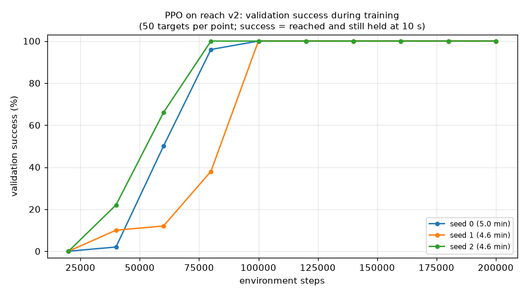
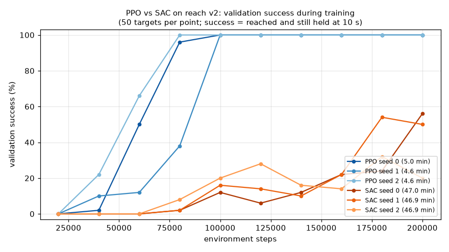
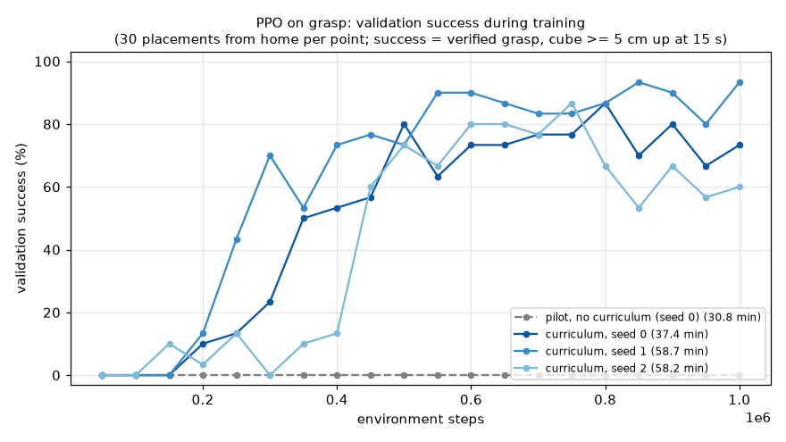

# Results

All numbers come from [`scripts/evaluate.py`](../scripts/evaluate.py) on the held-out set `reach_nominal_v1` (200 targets, digest `5b4bf7e75eec`) under the [evaluation protocol](evaluation_protocol.md). Raw outputs are in [`results/reach/`](../results/reach/).

## Reach: baselines (Milestone 2)

Evaluated at commit `774d38d` (clean tree). MuJoCo 3.16.0, Menagerie `cda5236f`.

| Policy | Success (95 % CI) | Time to success, median / p90 | Held after success | Final distance, median | Path ratio | Action jerk | Contact episodes | Latency, median / p99 |
|---|---|---|---|---|---:|---:|---:|---|
| Random | 0.0 % (0.0–1.9 %) | — | — | 375 mm | 2.50 | 4.67 | 0 % | 10 / 47 µs |
| Jacobian IK (k = 0.2, λ = 0.05) | 100.0 % (98.1–100 %) | 1.65 / 2.35 s | 100 % | < 0.001 mm | 1.00 | 0.015 | 0 % | 70 / 296 µs |

By region (success rate, n): IK reaches 100 % in all four regions (far-high 71, near-high 68, near-low 35, far-low 26). Random reaches 0 % in all four.

### Reading these numbers

- The **random policy** sets the floor. It never succeeds, ends a median 375 mm from the target (about where it started), and wanders along a path 2.5× longer than the straight-line distance.
- The **IK baseline** sets the ceiling for free-space reaching. It succeeds every time, follows a near-straight Cartesian path (ratio 1.00), holds every target, and its integral action removes the servos' gravity sag completely. Its advantage is an exact kinematic model; see the information-asymmetry note in [reach_task.md](reach_task.md#baselines-polypandacontrolclassical_baseline).
- Time to success is mostly set by the 0.3 rad/s joint speed limit of the action interface, not by the controller.
- Latencies are for single-observation `predict()` calls on the development laptop. Both are far below the 50 ms control period.

## Reach: PPO (Milestone 3)

Training: `configs/reach_ppo.yaml` on reach task **v2** (`configs/reach.yaml`). 200,704 environment steps per run, 8 `SubprocVecEnv` workers, observation and reward normalization, MLP 128×128 for both policy and value. The best checkpoint is chosen on a separate **validation** target stream, never the test set. Three seeds; each run took 4.6–5.0 min on the development laptop (CPU only).

Evaluated at commit `da4f5e0` (clean). Runs were trained at `dc3604b`, `748ef60` and `da4f5e0`, which differ only in docs and scripts.

| Policy | Success, pooled 600 episodes (95 % CI) | Held after success | Time to success, median / p90 | Final distance, median / worst | Path ratio | Action jerk | Contact episodes | Latency, median / p99 |
|---|---|---|---|---|---:|---:|---:|---|
| PPO v2, mean ± std over 3 seeds | 100 % (99.4–100 %) | 100 % | 1.70 ± 0.09 / 2.34 ± 0.06 s | 1.47 ± 0.25 / 5.8 ± 1.0 mm | 1.076 ± 0.007 | 0.044 ± 0.000 | 0 % | ~430 µs / 1.2–1.8 ms |
| Jacobian IK (for reference) | 100 % (98.1–100 %, 200 episodes) | 100 % | 1.65 / 2.35 s | < 0.001 / < 0.001 mm | 1.00 | 0.015 | 0 % | 70 / 296 µs |

Every seed reaches 100 % in all four regions, including the sparse far-low corner.

*Validation success during training for the three seeds (`scripts/plot_learning.py`). Success means the target was reached and was still held at the end of the 10 s episode. Seeds first reach 100 % at 80k–100k steps, roughly 1.1–1.4 hours of simulated experience.*

### Reading these numbers

- **PPO matches IK on what the task asks for** (success and holding) using only its 27-D observation and about 2.8 hours of simulated practice (200k steps × 0.05 s). IK, by contrast, has an exact kinematic model.
- **IK remains better on quality.** PPO is about 0.05 s slower in median time to success, settles about 1.5 mm off-centre instead of exactly on target, and its actions are about 3× jerkier. The hold reward's gradient inside the 2 cm ball is shallow, so there is little pressure to remove the last millimetre.
- **Inference** is about 6× slower than IK (a 128×128 MLP plus normalization, through SB3's `predict`), but still about 100× faster than the 50 ms control period.

### Pilot on task v1 (diagnostic, superseded)

The first PPO run (seed 0, 200k steps, `configs/reach_v1.yaml`) reached all 200 held-out targets (median 1.73 s) but **held only 14.5 %** and ended a median 38 mm away. The final checkpoint drifted into contact in 11 % of episodes. v1 ended episodes on success, so the policy never experienced post-success states. This is why the task was revised to v2 (see [reach_task.md](reach_task.md#task-versions)). These pilot numbers are reported for transparency; their result files were not archived because the evaluation ran on an uncommitted working tree.

## Reach: SAC vs PPO (Milestone 3)

SAC training: `configs/reach_sac.yaml` on the same task v2, with the same 128×128 networks, the same 200k-step budget, the same validation stream and the same held-out evaluation as PPO. SAC uses 4 envs, one gradient step per collected transition, automatic entropy tuning (SB3 default target entropy −7), observation normalization only, and 1 PyTorch thread. Hyperparameters were fixed **before** seeing results; SAC was not tuned after it under-performed. Trained and evaluated at commit `62e55bb` (clean).

| Policy (3 seeds × 200 targets) | Success, pooled 600 episodes (95 % CI) | Held after success | Time to success, median / p90 | Final distance, median | Path ratio | Action jerk | Training wall clock per seed |
|---|---|---|---|---|---:|---:|---|
| **PPO** | **100 %** (99.4–100 %) | **100 %** | 1.70 ± 0.09 / 2.34 ± 0.06 s | **1.5 ± 0.3 mm** | 1.08 | 0.044 | **~5 min** |
| SAC | 63.2 % (59.2–66.9 %) | 43 ± 19 % | 1.98 ± 0.28 / 4.24 ± 0.16 s | 27 ± 6 mm | 1.16 | **0.032** | ~47 min* |
| Jacobian IK (reference) | 100 % | 100 % | 1.65 / 2.35 s | < 0.001 mm | 1.00 | 0.015 | — |

\* The three SAC seeds ran in parallel. A single SAC run alone measured about 94 steps/s, roughly 35 min for 200k steps.

Per-seed SAC held-out success: 69.0 %, 62.0 %, 58.5 %. Validation success at 200k steps was still changing (56 %, 50 %, 20 %), so SAC had not converged within this budget.

### Why SAC lagged here

- **The entropy temperature collapsed early.** In all three seeds, SAC's automatically tuned `ent_coef` fell from 0.89 to about 0.0015 within the first ~36k steps and stayed there. The policy became nearly deterministic and stopped exploring.
- **The hold reward was discovered late.** The hold term only pays inside the 2 cm tolerance ball. In the training rollouts it first appears at 114k–171k steps. Until then SAC's critics had no evidence that the ball was worth entering, and the policy settled 3–5 cm away, collecting only the telescoping progress reward. PPO kept substantial Gaussian exploration noise (std ≈ 0.7 at 200k steps), entered the ball early, and learned to hold by 80k–100k steps.
- **Gradient updates were the bottleneck.** An SAC update (actor, twin critics, entropy temperature) took about 9 ms on this CPU, nearly independent of thread count (1 thread was fastest). With one update per transition, SAC trains at about 94 steps/s, against PPO's ~700 steps/s with batched updates.
- **SAC's actions were smoother** (jerk 0.032 vs 0.044). Its lower final-step entropy shows up as steadier commands, but that does not compensate for the lower success rate.

**Scope of the claim:** with default hyperparameters and an equal 200k-step budget, PPO clearly beat SAC on this task in sample efficiency, final quality and wall clock. This is a statement about this reward structure and configuration, not about SAC in general. A follow-up that keeps exploration alive, such as a higher target entropy or a lower bound on `ent_coef`, would test the explanation above. It would be reported as a separate, labelled experiment, not as a replacement for this comparison.

## Grasp: scripted baseline (Milestone 4)

Held-out placement set `grasp_nominal_v1` (200 cube placements, digest `ad1eeb22b054`). **Success** means the verified grasp predicate (both fingers in contact, lifted ≥ 2 cm, under 2 mm / 0.05 rad of in-hand motion over 0.25 s) holds at the end of the episode. Details are in [grasp_task.md](grasp_task.md). Evaluated at commit `2249cd3` (clean).

| Controller | Success (95 % CI) | Time to first grasp, median / p90 | Cube pushed before closing | Tilt in grip, median / max | Floor contact |
|---|---|---|---|---|---|
| Scripted top-down grasp (PoseIK, privileged cube pose) | **100 %** (98.1–100 %) | 6.95 / 8.50 s | 0.00 mm | 4.7° / 14.8° | 0 % |

## Grasp: learned (PPO) vs scripted

Comparison protocol: every policy acts through `GraspEnv` for the full 15 s from home, with the env's gate closing the fingers. Success means a verified grasp with the cube ≥ 5 cm up at the final step. Same 200 placements. Curriculum PPO runs were trained and evaluated at `1d00632`; the pilot and the scripted row at `12f57b8` (all clean). Full analysis: [grasp_task.md](grasp_task.md#learning-to-grasp-ppo).

| Policy | Success (95 % CI) | Time to first success, median | Share of episode in success state | Floor-contact episodes | Return |
|---|---|---|---|---|---|
| Scripted baseline | **100 %** (98.1–100 %) | 6.98 s | 52.8 % | **0 %** | 89.2 |
| PPO, no curriculum (pilot, 1 seed) | 0 % (0–1.9 %) | — | 0 % | 0 % | 8.7 |
| **PPO + pre-grasped training starts** (3 seeds, pooled 600) | 80.5 % (77.1–83.5 %); 80.5 ± 5.4 per seed | **4.31 ± 0.12 s** | **69.7 %** | 8.2 ± 4.8 % | 89.7 ± 3.5 |

- **Exploration is the bottleneck.** Plain PPO learned to centre and align so the gate closed (84 % of episodes) but never learned to lift. Its action noise collapsed before it experienced a single hold. Starting 30 % of training episodes with the cube already in the hand let it learn lifting, and it then chained the two halves from home. Evaluation never uses these starts.
- **The learned policy is faster but less reliable.** It is about 2.7 s quicker to a verified grasp than the deliberately slow scripted baseline, but succeeds 80.5 % vs 100 %, and touches the floor in about 8 % of episodes.
- **Main weakness:** cubes about 45° off the wrist's start angle (two equally good grasp yaws) succeed only 54 %. No placement is failed by all three seeds.

## Transport (Milestone 4)

Held-out set `transport_nominal_v1`: 200 grasp-to-transport handoff states, 50 each from the scripted grasp and PPO grasp seeds 0–2, each with a 3-D goal at least 15 cm away. **Success** means the cube centre is within 2 cm of the goal with a verified grasp, held to the end of the 10 s episode, and not dropped. Task v2 labels; all evaluations at clean commits. Full analysis: [transport_task.md](transport_task.md).

| Policy | Success (95 % CI) | Lost grip | Lowered onto table | Time to first success, median | Action jerk |
|---|---|---|---|---|---|
| **Scripted closed-loop carry** | **92.0 %** (87.4–95.0 %) | 7.5 % | 0 % | 2.05 s | **0.0015** |
| PPO v1 pilot | 0 % (0–1.9 %) | 14.5 % | 85.5 % | — | — |
| PPO v2 pilot (height-keeping signal) | 0 % (0–1.9 %) | 49.0 % | 51.0 % | — | 0.135 |
| PPO residual on the scripted carry | 92.5 % (88.0–95.4 %) | 6.5 % | 0 % | **1.90 s** | 0.0175 |

- **Plain PPO could not learn to carry.** Swinging the cube sideways with uncoordinated joint increments sank it onto the table. With a height-keeping signal it lost the grip instead. The hold reward was never discovered in 1M steps.
- **Residual RL matched but did not improve the scripted carry.** Paired on the same cases, both fail the same 14 (discordant 2 vs 1, exact McNemar p = 1.0).
- **Transport reliability is limited by grasp quality.** Failures are cubes creeping out of off-centre grips while held at the goal: 100 % success from scripted-grasp handoffs vs 84 % from PPO grasp seed 0's.
- **The scripted closed-loop carry is the transport skill** used for pick-and-place.

## Place (Milestone 5)

Held-out set `place_nominal_v1`: 198 transport-to-place handoffs (the cube held 12 cm above a target spot), covering all four grasp sources. **Success** means a verified placement: resting within 3 mm of the table, under 10° of tilt, within 2 cm of the target, still, and clear of the gripper for 0.5 s. Evaluated at commit `e2c59bc` (clean). Full analysis: [place_task.md](place_task.md).

| Controller | Success (95 % CI) | Time to verified placement, median / p90 | Final xy error, median / p95 | Failures |
|---|---|---|---|---|
| **Scripted place with upright correction** | **97.5 %** (94.2–98.9 %) | 2.05 / 3.90 s | 1.7 / 16.7 mm | toppled 2, off target 1, never released 1, not settled 1 |

- **Tilt at release decides toppling.** Cubes released with 0–25° of tilt in the fingers never toppled, those at 25–35° toppled 11 % of the time, and those beyond 35° always toppled (the 4 × 4 × 6 cm cube tips over beyond atan(2/3) ≈ 34°). Rotating the hand so the cube stands upright before lowering raised success from 90.4 % to 97.5 % and cut the median xy error from 6.3 to 1.7 mm.
- **RL for placing was not attempted:** the baseline leaves too little to improve.

## Pick-and-place, end to end (Milestone 5)

Held-out set `pickplace_nominal_v1`: 200 scenes (cube start pose and a target at least 10 cm away), every episode from the home pose, through the [supervisor](pick_and_place.md) with up to two re-grasps and a 90 s budget. Transport and place are scripted in every configuration. Evaluated at commit `a8fced5` (clean).

| Grasp skill | Success (95 % CI) | First attempt | Retried → recovered | Time to placed, median / p90 | Final xy error, median |
|---|---|---|---|---|---|
| **Scripted** | **100 %** (98.1–100 %) | 97.5 % | 5 → 5 | 12.4 / 15.8 s | 1.7 mm |
| PPO seed 0 | 86.0 % (80.5–90.1 %) | 75.0 % | 33 → 22 | 10.3 / 28.9 s | 1.8 mm |
| PPO seed 1 | 89.0 % (83.9–92.6 %) | 84.0 % | 20 → 10 | 9.7 / 13.9 s | 1.5 mm |
| PPO seed 2 | 83.0 % (77.2–87.6 %) | 76.0 % | 32 → 14 | 9.3 / 13.2 s | 1.7 mm |
| PPO, pooled 600 | 86.0 % (83.0–88.5 %); 86.0 ± 3.0 per seed | 78.3 % | 85 → 46 | | |

- Final failures with the PPO grasp occur at the grasp stage 77 times, transport 2 and place 5. The grasp failures are cubes pushed out of the workspace (30), knocked over (25), or missed on all three attempts (22).
- Paired against all-scripted on the same scenes, every PPO seed is significantly worse (exact McNemar p ≤ 4.8 × 10⁻⁷).
- Retries lift the learned chain from 78.3 % (first attempt, close to the standalone grasp rate of 80.5 %) to 86.0 %.

## Grasp v2 (Milestone 6.2)

A second grasp task targeted v1's two weaknesses: the 45° tie and pushing the cube out of reach. Full analysis: [grasp_task.md](grasp_task.md#task-v2-milestone-62). Same held-out set and protocol as v1, 3 seeds each:

| Policy | Held-out grasp (pooled 600) | Pick-and-place (pooled 600) |
|---|---|---|
| PPO grasp v1 | 80.5 % (77.1–83.5 %) | 86.0 % (83.0–88.5 %) |
| v2, all changes (committed yaw + pushing penalty + cube randomization) | 4.5 / 26.0 / 23.0 % per seed | 14.0 / 26.5 / 42.0 % per seed |
| **v2, committed yaw only** (adopted) | **87.0 %** (84.1–89.5 %) | **89.2 %** (86.4–91.4 %) |

- The full v2 policies learned to hover about 1 cm short of the cube; the pushing penalty discouraged the contact a grasp needs. The committed yaw alone improved the grasp significantly (paired exact McNemar p = 0.002) and the 40–45° case from 54 % to 65 %.
- End to end the gain is +3.2 points, consistent across seeds but not significant (p = 0.09).

## Robustness (Milestone 6.1)

The full pick-and-place system on the same 200 scenes under perturbations it was never trained on. Each PPO column pools 3 seeds. Details and plot: [robustness.md](robustness.md).

| Condition | Scripted grasp | PPO grasp v1 | PPO grasp v2 |
|---|---|---|---|
| nominal | 100 % | 86.0 % | 89.2 % |
| cube mass × 0.5–2 | 84.5 % | 70.5 % | 74.3 % |
| friction × 0.5–1.5 | 88.5 % | 72.7 % | 79.7 % |
| cube size × 0.85–1.15 | 99.5 % | 83.5 % | 89.2 % |
| start pose ± 0.1 rad per joint | 100 % | 82.3 % | 86.5 % |
| push 0–2 N during transport | 66.0 % | 62.0 % | 64.8 % |
| all combined | 55.5 % | 45.3 % | 48.7 % |
| cube outside the training region | 99.0 % | 63.7 % | 58.0 % |

- The gripper's roughly 2 N of grip is the physical limit. Heavy cubes, slippery cubes and pushes above about 1 N slip out during transport, whichever grasp picked them up.
- The learned grasp does not extrapolate beyond the region it was trained on; the scripted grasp, planning from the measured pose, does.

## Supervisor ablations (Milestone 6.3)

Removing one supervisor design choice at a time; same 200 scenes, paired with the full system. Details: [pick_and_place.md](pick_and_place.md#ablations-milestone-63-what-each-supervisor-design-choice-is-worth).

| System | Scripted grasp | PPO grasp v2 (pooled 600) |
|---|---|---|
| Full system | 100 % | 89.2 % |
| No retries | 97.5 % | 83.3 % |
| Timed switching instead of verified handoffs | 84.5 % | 71.2 % |
| No upright correction before release | 97.0 % | 81.5 % |

## Generalizing the grasp (Milestone 7)

Can training make the learned grasp work across the whole table and among other cubes? Target: at least 85 % on a wide held-out set covering the whole feasible table, and at least 87 % on the original set. Full analysis: [generalization.md](generalization.md). All grasp numbers pool 3 seeds (600 episodes); checkpoints are chosen on 100-episode validation sets, never on test sets.

| Grasp | Original grasp | Wide grasp | Clutter grasp (2 other cubes) | Pick-and-place original | Pick-and-place wide |
|---|---|---|---|---|---|
| **Scripted** | **100 %** | **100 %** | **100 %** | **100 %** | **98.5 %** |
| PPO v2 (adopted), selected checkpoints | 89.8 % | 81.8 % | 78.8 % | 89.0 % | 81.2 % |
| PPO trained on the wide region | 85.7 % | 81.3 % | 80.5 % | 86.8 % | 80.8 % |
| PPO v3, trained among other cubes | 65.0 % | 56.2 % | 41.5 % | | |

- **Target not met.** The best learned result on the wide set is 81.8 %.
- **Better checkpoint selection mattered more than wider training.** Re-scoring saved checkpoints on 100 episodes instead of 30 raised the v2 grasp on the wide set from 76.2 % to 81.8 %, as much as training on the wide region did.
- **Training among other cubes backfired:** the penalty for disturbing them taught hesitation (258 of 351 clutter failures never closed the fingers).
- **Seeds disagree:** the same configuration gives 66–94 % (wide) and 21.5–67 % (v3) per seed.

## Hand-motion actions and the fully learned chain (Milestone 8)

Policies can command the hand (x, y, z, plus wrist yaw or full rotation) instead of seven joint increments; inverse kinematics turns the hand motion into joint targets. With this, PPO learned all three skills. Full analysis: [cartesian_actions.md](cartesian_actions.md). Learned numbers pool 3 seeds; the scripted controllers are the reference baselines.

| Skill, held-out set | Learned (hand motion) | Scripted baseline |
|---|---|---|
| Grasp, original / wide / clutter | 91.3 / 85.0 / 84.7 % | 100 / 100 / 100 % |
| Transport (200 cases), top speed 0.12 m/s | 90.2 % (per seed 89.0 / 89.5 / 92.0; p = 0.16 vs scripted) | 92.0 % |
| Transport, first version at 0.2 m/s | 76.2 % (per seed 83.5 / 60.0 / 85.0) | |
| Place (198 cases) | 95.1 % | 97.5 % |

| Pick-and-place, 200 scenes | Original | Wide |
|---|---|---|
| **Fully learned chain** (grasp, transport and place all PPO) | **88.5 %** (per seed 78.5 / 96.0 / 91.0) | **80.8 %** |
| Learned grasp only | 91.8 % | 86.7 % |
| Learned transport only | 99.5 % (p = 0.25 vs scripted) | |
| Learned place only | 99.5 % (p = 0.5 / 1 / 1 vs scripted) | |
| All scripted (baseline) | 100 % | 98.5 % |
| v1.0 system (learned grasp only, joint actions) | 89.0 % | 81.2 % |

- **The hand-motion grasp meets the Milestone 7 target** (at least 85 % wide, at least 87 % original). Its gain over the joint-action grasp is significant in clutter (p = 0.004) and end to end on the wide scenes (p = 0.004).
- **Transport was learned for the first time.** Two pilots failed first: one spun the wrist and flung the cube; in the other the policy's mean action drifted past its bounds, where clipping hid it from learning. The fixes were a 3-D action without wrist rotation and an out-of-bounds penalty. Failure analysis then showed the first learned transport carried too fast: test-time checks ruled out acceleration and confirmed speed. Retrained at 0.12 m/s, it matches the scripted carry.
- **Learned transport and learned place match their scripted versions inside the full task.**
- **The fully learned chain equals the v1.0 system** (paired p = 0.84 original, 0.93 wide), which had only one learned skill. It is about 40 % faster than scripted (about 7.5 s vs 12.4 s per cube) and less precise (4–7 mm vs 1.7 mm). Its weakest link is now the grasp.

## Recovering from knocks (Milestone 10)

The work-order cell with one knock per order: it reads its towers, notices the knock and rebuilds. Targets were committed before the work ([v3_targets.md](v3_targets.md)); full analysis: [recovery.md](recovery.md). Learned numbers pool 3 seeds.

| New skill, one-shot held-out set (600 cases) | Learned (PPO) | Scripted | Target |
|---|---|---|---|
| Grasp a cube lying on its side | 84.8 % (79.0 / 84.0 / 91.5) | 84.0 % (p = 0.74) | 85 % |
| Stand a held cube upright beside towers (+ turn chooser, shield, re-planning) | 87.7 % (89.5 / 90.5 / 83.0) | 93.0 % (p = 0.001) | 90 % |

| Held-out disturbance suite (200 orders), recoverable knocks completed | Learned skills | Scripted skills | Target |
|---|---|---|---|
| One cube falls (D1) | **93.2 %** (218/234) | 96.2 % (76/79) | 90 % |
| Part of a tower falls (D2) | **87.5 %** (28/32) | 8/8 | 85 % |
| The whole tower falls (D3) | **91.5 %** (75/82) | 86.7 % (26/30) | 80 % |
| All orders, every knock | 77.5 % | 78.5 % (p = 0.58) | |
| Without recovery (v2 behaviour, scripted) | | 44/200 | |

| Recovery planner, 2 spares, deadline 1.5 × undisturbed time | Symbolic cell (10,000 games per policy) | Physics cell (470 knocked orders) |
|---|---|---|
| Rescue every cube, replace the rest | 89.0 % | 84.3 % |
| Best of 32 hand-written rules | 92.5 % | **88.3 %** |
| **Learned planner** (PPO, 3 seeds) | **94.3 %** (p < 1e-29 vs best rule) | 86.2 % (p = 0.08 vs best rule) |

- **Every recovery target is met with learned skills only**, level with the scripted cell on the same orders. About a third of knocks cannot be recovered by any robot; they are run and reported, not counted in the targets.
- **Both new skills just miss their own targets** on one-shot sets, and neither was trained with randomized cube size.
- **The learned planner beats every hand-written rule in the symbolic cell, not in physics.** Headroom checks before training had shown rules to be near-optimal; in physics, the cubes it leaves for spares get in the way of later placements, which the symbolic cell does not model.

## v3.1: new skills and a clutter-clearing rule (Milestone 11)

Targets were committed before the work ([v3_1_targets.md](v3_1_targets.md)); full analysis: [recovery.md](recovery.md#v31-milestone-11-new-skills-and-clearing-clutter). Learned numbers pool 3 seeds (600 cases), with Wilson 95 % intervals and exact McNemar tests paired on the same cases. v3.0's numbers sit beside every v3.1 number.

| Skill, fresh one-shot set (600 cases) | **v3.1 learned** | v3.0 learned, same cases | Scripted | Size ×0.85–1.15 (v3.1) | Target |
|---|---|---|---|---|---|
| Grasp a cube lying on its side, `grasp_lying_final_v2` | **97.8 %** (96.3–98.7) | 95.5 % (`anypose5`, p = 0.034); 87.7 % (`anypose4`, p = 3e-13) | 84.5 % (p = 5e-16) | 96.7 % (gap −1.2; bar 5) | 85 %: **met** |
| Stand a held cube upright beside towers, `standup_final_v2` | **90.0 %** (87.3–92.2) | 88.2 % (round 11, p = 0.2) | 90.5 % (p = 0.81) | 88.3 % (gap −1.7); v3.0 76.8 % (p = 1e-10) | 90 %: **met** |

v3.0's own one-shot results were 84.8 % (grasp) and 87.7 % (stand-up), both just short. Both v3.1 skills were trained with a randomized cube size.

| Held-out disturbance suite v2 (200 new orders, 3 seeds) | **v3.1 cell**: clear rule, 2 spares, deadline | Best rule, same skills and spares | v3.0 learned planner, same skills and spares | v3.1 skills, no spares | v3.0 cell | Scripted, recovery | Scripted, no recovery |
|---|---|---|---|---|---|---|---|
| All orders | **87.0 %** | 87.2 % | 85.7 % | 78.0 % | 81.5 % | 82.0 % | 21.5 % |
| Knocked orders (D1–D3) | **86.0 %** | 86.5 % | 84.3 % | 75.4 % | 77.5 % | 77.2 % | 0.6 % |
| No knock (D0, planned controls) | 96.3 % | 95.4 % | 96.3 % | 95.4 % | 96.3 % | 36/36 | 36/36 |

| Target or regression bar | Result | Bar | |
|---|---|---|---|
| Knocked orders: clear rule better than the best rule | 86.0 % vs 86.5 %; 11 vs 13 orders only one completed; p = 0.84 | p < 0.05 | **missed** |
| Recoverable D1 (v3.1 skills, no spares) | 90.6 % (242/267) | 90 % | met |
| Recoverable D2 | 89.2 % (33/37) | 85 % | met |
| Recoverable D3 | 89.8 % (53/59) | 80 % | met |
| No knock (D0) | 96.3 % (v3.1 cell), 95.4 % (no spares) | 99 % | **missed** (all misses on seed 0; the v3.0 cell: 96.3 %) |

- **Both new skills meet their targets,** and the stand-up is now level with the scripted planner.
- **The clear rule removed the clutter but not the losses.** Tower places with a loose cube within 6 cm fell from 243 to 19, and failed places from 119 to 71. But failed places are mostly retried, and clearing costs time: 37 knocked orders finished late against 26.
- **Seed 0's grasp is the weak point.** It knocks over 2.0 % of upright belt cubes and 16 % of upright floor cubes in the cell; seeds 1–2 almost never do. Both trace to the cube's rotation relative to the hand. On seeds 1 and 2, the v3.1 cell completes 93.5 % of all orders and every order with no knock. Proposed fixes: [v3_2_candidates.md](v3_2_candidates.md).

## v3.2: a grasp round for the cell's picks

Targets were committed before any v3.2 training ([v3_2_targets.md](v3_2_targets.md)). New cell-like pick checks run the grasp through the cell's own pick, one upright cube per case: on the belt (turned up to ±15°) or on the floor near the base (turned −45..+45°), with the same cases at cube size ×0.85–1.15. Every grasp is reported per seed (0 / 1 / 2, 200 cases each) and by 10° rotation bin, so one weak seed cannot hide behind two good ones. Exact McNemar tests pool the 3 seeds, paired on the same cases; v3.1's and v3.0's grasps and the scripted pick run on the same cases.

| Grasp round, development sets (at most 3 rounds) | Belt bar | Floor bar | Lying `grasp_lying_final_v1`, against v3.1's 97.8 % | Outcome |
|---|---|---|---|---|
| 1, `grasp_anypose7` (rotation coverage near the base, belt-height cubes, no finger on the top, large cubes) | met | missed (seed 0, +25..+45°) | 94.2 % (p = 0.001) | not a lock candidate |
| 2, `grasp_anypose8` (lying share restored, a cost for the open hand low beside the cube), best checkpoints | missed (seed 0: 77.0 %) | missed (seed 0) | 97.7 % | checkpoint rule changed to final (post hoc, recorded before any final result) |
| 2, final checkpoints | met | met | 93.5 % (p = 0.0002) | not a lock candidate |
| 3, `grasp_anypose9` (round 2's task, mixed validation, learning rate halved), best checkpoints | met | missed (seed 0: 94.5 %, −45..−35° bin 9/18) | 97.7 % (p = 1) | not a lock candidate: **v3.2 grasp target not met** |

**Decision after the development results (user, post hoc):** the cell uses `grasp_anypose9` from v3.2 on. It is an adoption, not a lock; the v3.2 grasp target stays not met. The one-shot sets were then run once on it, with the baselines on the same cases:

| One-shot set, run once (per seed 0 / 1 / 2) | **v3.2 `grasp_anypose9`** | v3.1 `grasp_anypose6`, same cases | v3.0 `grasp_anypose5` | Scripted | Bar (per seed unless stated) |
|---|---|---|---|---|---|
| Belt, `grasp_belt_final_v1` | **100 / 100 / 100 %**, none knocked over | 97.5 / 100 / 100 %, 5 knocked over (p = 0.063) | 100 %, none | 100 % | ≥ 99 % and ≤ 1 knocked over: **met** |
| Floor, `grasp_floor_final_v1` | **94.5** / 100 / 100 %; seed 0's −45..−35° bin 14/23 | 89.5 / 100 / 100 %; 12/23 (p = 0.021) | 88.0 / 100 / 100 %; +35..+45° 2/20 | 100 % (p = 0.001) | ≥ 95 %, no 10° bin under 85 %: **missed** (seed 0) |
| Floor, size ×0.85–1.15 | 94.0 / 100 / 100 %, gap −0.2 points | 81.5 / 99.5 / 99.0 %, gap −3.2 (p = 4e-6) | gap −2.8 | 100 %, gap 0 | within 5 points, pooled: met |
| Lying, `grasp_lying_final_v2` (v3.1's one-shot set) | **98.3 %** (97.0–99.1; 98.0 / 98.5 / 98.5) | 97.8 % (p = 0.65) | 95.5 % | 84.5 % | no significant drop against v3.1: met |

| Held-out disturbance suite v3 (200 orders, 3 seeds) | v3.2 cell (`grasp_anypose9`, v3.1's stand-up, place and recovery) | v3.1 cell, same orders | Scripted cell | Target |
|---|---|---|---|---|
| All orders | **91.5 %** (549/600; 89.0–93.5) | 85.7 % (514/600; p = 5e-6: 47 / 12) | 82.0 % (164/200) | v3.2 significantly more than v3.1 (p < 0.05): **met** |
| Recoverable D1 / D2 / D3, no spares | **96.2 / 95.8 / 92.3 %** | not run | 97.3 / 80.0 / 75.9 % | 90 / 85 / 80 %: met |
| No knock (D0, the suite's planned controls) | **99.3 %** (149/150); no spares 98.7 % (148/150) | 92.0 % (138/150) | 100 % | 99 %: met by the v3.2 cell, **missed** by the no-spares configuration (one order short) |

*Run once from `50afb4c`, locked before any run on the suite ([v3_2_targets.md](v3_2_targets.md#the-final-cell-run-as-it-came-2026-11-22)). The gain is all on seed 0, 89.5 against 71.0 % (v3.1's grasp knocked over 50 cubes there, the new one 3); seeds 1 and 2 are level (p = 1). The three missed no-knock orders are all on seed 0 and none is a knock-over: two towers finished wrong and one pick timed out. On v3.1's suite (development) the same two cells scored 93.2 and 87.0 %.*

- **The v3.2 cell target is met:** the new grasp removes seed 0's knock-overs from the cell, and the recovery skills keep their v3 targets.

- **The belt is fixed on every seed.** No cube is knocked over on either belt set, where v3.1's seed 0 knocked over 4 and 5.
- **The adopted grasp is significantly better than v3.1 on the floor** (p = 0.021) **and on the size-varied floor** (p = 4e-6), with no lying regression (98.3 against 97.8 %, p = 0.65).
- **Seed 0's floor weakness remains,** on the same kind of case in both sets: standing cubes near the base turned close to −45°. It is still behind the scripted pick there (0 / 11, p = 0.001).
- **The stand-up was not retrained.** v3.1's stand-up learned from `grasp_anypose6`'s hand-offs, so the v3.2 cell pairs it with a grasp it was not trained after.

## v4.0: a learned door for machines it has not seen

The skill opens or closes the sliding lid of a benchtop machine it has never seen ([door_env.md](door_env.md)). Every episode draws a new machine: which way the lid slides (right, left or out) and how far, its friction and damping, a closing spring with a hold-open notch on half of them, where the handle sits and how high, how fast the latch needs the lid to arrive, and where the machine stands and how it is turned. None of these is observed. The robot sees its own arm, a camera estimate of the handle (1 mm error), contact and force estimates, and the machine's door signals. Targets were committed before any training ([v4_targets.md](v4_targets.md)). The baselines are three scripts on the same machines: `nominal` (written for one nominal machine), `camera` (handle located by camera) and `feel` (camera, and it feels: it tries the other way when blocked, pushes to the stop and retries a latch). All runs have 400 episodes; the learned skill runs 3 seeds.

| Development, `door_dev_v1` (per seed 0 / 1 / 2) | Success | Worst cell | Median steps | Median peak force | Slams (T4: ≤ 4) |
|---|---|---|---|---|---|
| Clone of the feel script's demonstrations (seed 0) | 43 / 400 | 0 % | 207 | 42 N | 0 |
| PPO from scratch, 3M steps (seed 0, reference) | 169 / 400 | 0 % | 95 | 65 N | 25 |
| Round 1: PPO from the clone, best checkpoints | 394 / 397 / 396 | 87 / 93 / 92 % | 54 / 55 / 80 | 38–41 N | 29 / 31 / 0 |
| Round 2: a penalty per slam, best | 398 / 400 / 399 | 96 / 100 / 98 % | 53–61 | 41–47 N | 12 / 12 / 3 |
| Round 3: slam penalty from 0.12 m/s, **final** checkpoints (rule changed before seeds 1–2) | 400 / 397 / 392 | 100 / 94 / **76 %** | 52–55 | 36–40 N | 2 / 2 / 1 |
| Round 4: the machine's **door-open switch** observed, final | 398 / 400 / 399 | 97 / 100 / 98 % | 51–53 | 37–40 N | 1 / **11** / **5** |
| Round 5 (one more than the 4 planned): slam penalty from 0.10 m/s, force penalty from 20 N, final | 399 / 394 / 400 | 98 / 91 / 100 % | 50–52 | 30–32 N | 2 / 1 / **5** |
| feel / feel_v2 (the feel script, and with the door-open switch) | 393 / 393 | 88 / 88 % | 180 / 178 | 45 / 25 N | 0 / 0 |
| camera / nominal | 196 / 61 | 0 / 0 % | 188 / 152 | 22 / 11 N | 0 / 0 |

- **Demonstrations first, then RL.** Cloning the feel script alone solves 11 % of the machines; PPO from the clone reaches 99 % in one round, where PPO from scratch reaches 42 % in 3M steps.
- **Round 4's switch.** Round 3's seed 2 let go of springy lids a few millimetres short of their hold-open notch; the spring pulled them shut, and with nothing observed at the open end, the hand never went back. Real machines expose a door-open switch beside the door-closed one; with it, a hand that let go early went back 37 times out of 38, and seed 2's weak cell went from 16/21 to 21/21. The feel script got the same switch (`feel_v2`): it ends an open when the switch comes, so its median peak force fell from 45 to 25 N.
- **Round 5,** one more than the 4 rounds the targets allowed, added openly before training ([v4_targets.md](v4_targets.md)): slams were at the 1 % bar in every round (a checkpoint's count is a draw: 5 to 17 per 1200 between checkpoints of rounds 3 and 4), and the force peaks were free impacts at the bar and at the stop under a 40 N penalty threshold. It halved slams and cut force by 7 N.

| One-shot `door_final_v1`, run once from the lock (`0cf6f2b`) | **Learned (round 5, final checkpoints)** | feel_v2 | camera | nominal | Target |
|---|---|---|---|---|---|
| Success, per seed 0 / 1 / 2 | **400 / 398 / 397** (pooled 99.6 %) | 393 (98.2 %) | 183 (45.8 %) | 69 (17.2 %) | T1: ≥ 95 % per seed: **met** |
| Worst command × slide × spring cell | **100 / 96 / 91 %** | 86 % | 0 % | 0 % | T1: ≥ 90 % in every cell, every seed: **met** |
| Against the camera script, pooled | 647 episodes only the learned skill completes, 1 only the script (p = 1e-192) | | | | T2: significantly better: **met** |
| Against the feel script, pooled | +1.3 points; median **49 against 177 steps** on the 1174 episodes both complete (72 % shorter) | | | | T3: ≥ −2 points and ≥ 20 % shorter: **met** |
| Median peak force, pooled | 30.9 N (opens 29.7, closes 31.9) | 25.6 N (opens 20.6, closes 38.7) | 19.7 N | 8.8 N | T4: no higher than feel_v2: **missed** |
| Slam episodes, per seed | 1 / 2 / 3 | 0 | 0 | 0 | T4: ≤ 1 % per seed: **met** |

*Run once at `0cf6f2b`, the lock committed and pushed before any run on the set, with the scoring script `scripts/door_final_report.py`; results in `2505955`. Development numbers are flattering after five rounds on that set; the one-shot came out level with them.*

- **The learned door works on machines it has not seen:** 99.6 % on 400 new machines, against 46 % for the camera-located script and 17 % for the script written for one machine.
- **It matches the well-written feel script and is 3.6× faster.** The feel script still fails 7 of 400 (5 closes not shut on right-sliding lids, 2 opens).
- **It is not as gentle (T4 missed).** Pushing a lid takes about 6 N; the peaks are impacts when the fingers meet the bar and the lid meets its stop, and the robot arrives at 0.2 m/s where the script creeps at 0.05. On closes it is gentler than the script (32 against 39 N), on opens harder (30 against 21 N), and it has more hard knocks: 20 % of episodes above 50 N against 8 %, the hardest 224 N against 108 N.
- **Seed 2's old weak spot shows:** all 3 of its failures are springy right-sliding lids not opened (that cell 91 %, just above the bar). Seed 1 failed one open and one close that did not latch; seed 0 none.
**In the line (T5, reported with no bar).** The door inside the full tending cycle on the line's M1: drive along the rail, open, pick the raw part, load it, close; success = the machine running at the end. Driving, picking and loading are the line's scripted moves with the same camera estimate for every door actor; only the door changes. Each run was fixed in [v4_targets.md](v4_targets.md) before it ran, and run once.

| Machines running (of 100) | Learned, seeds 0 / 1 / 2 | feel_v2 | camera | line_camera | Median cycle, learned / feel_v2 |
|---|---|---|---|---|---|
| T5, machines 0–99, door handed over from the line's carry posture | 74 / 64 / 63 (67 %) | **89** | 35 | 9 | 30.6 / 43.0 s |
| T5b, machines 100–199, door handed over at its trained start | **96 / 96 / 94 (95.3 %)** | 94 | 40 | 19 | **31.3 / 44.6 s** |

- **T5 found a weakness the bare door test could not:** the line handed the door over with the hand about 31 cm above the handle, where every training episode started about 8 cm above. The policy reached the handle but let go of lids short of open enough (mostly left-sliding and springy ones), behind the feel script (p = 4e-12).
- **T5b, the hand-over fixed (motivated by T5, so post hoc, on machines no line run had used):** the line lowers the hand to the door's trained start first, for every door actor. The learned door is then **level with the feel script (95.3 against 94.0 %, p = 0.29) and about 13 s faster per machine cycle**, and far ahead of the camera scripts. Its doors opened and closed on 298 of 300 tries; four machines failed for every actor because the scripted load did not seat the part.
- **Candidates for v4.1:** train the door from a wide range of start poses so it does not depend on the hand-over; slow down just before contact and before the stop (the force gap); seed 2's springy right-sliding lids; the scripted load on left-sliding lids. Measured on a fresh one-shot set.
