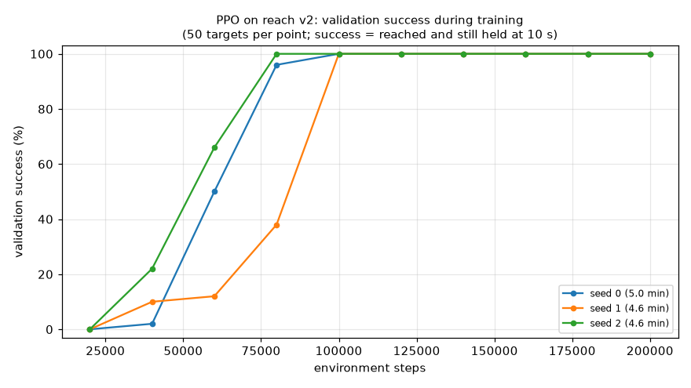
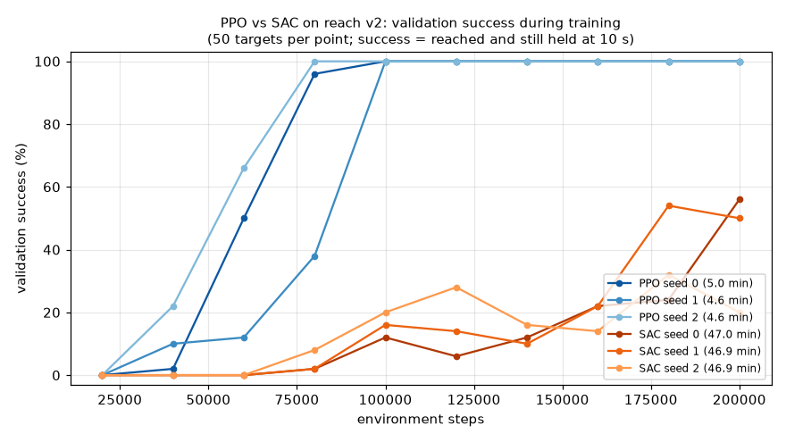
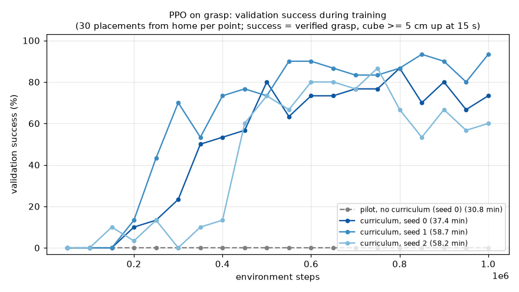

# Results

All numbers come from [`scripts/evaluate.py`](../scripts/evaluate.py) on the held-out set `reach_nominal_v1` (200 targets, digest `5b4bf7e75eec`) under the [evaluation protocol](evaluation_protocol.md). Raw outputs are in [`results/reach/`](../results/reach/).

## Reach: baselines (Milestone 2)

Evaluated at commit `774d38d` (clean tree). MuJoCo 3.16.0, Menagerie `cda5236f`.

| Policy | Success (95 % CI) | Time to success, median / p90 | Held after success | Final distance, median | Path ratio | Action jerk | Contact episodes | Latency, median / p99 |
|---|---|---|---|---|---:|---:|---:|---|
| Random | 0.0 % (0.0–1.9 %) | — | — | 375 mm | 2.50 | 4.67 | 0 % | 10 / 47 µs |
| Jacobian IK (k = 0.2, λ = 0.05) | 100.0 % (98.1–100 %) | 1.65 / 2.35 s | 100 % | < 0.001 mm | 1.00 | 0.015 | 0 % | 70 / 296 µs |

By region (success rate, n): IK reaches 100 % in all four regions (far-high 71, near-high 68, near-low 35, far-low 26). Random reaches 0 % in all four.

### Reading these numbers

- The **random policy** sets the floor. It never succeeds, ends a median 375 mm from the target (about where it started), and wanders along a path 2.5× longer than the straight-line distance.
- The **IK baseline** sets the ceiling for free-space reaching. It succeeds every time, follows a near-straight Cartesian path (ratio 1.00), holds every target, and its integral action removes the servos' gravity sag completely. Its advantage is an exact kinematic model; see the information-asymmetry note in [reach_task.md](reach_task.md#baselines-polypandacontrolclassical_baseline).
- Time to success is mostly set by the 0.3 rad/s joint speed limit of the action interface, not by the controller.
- Latencies are for single-observation `predict()` calls on the development laptop. Both are far below the 50 ms control period.

## Reach: PPO (Milestone 3)

Training: `configs/reach_ppo.yaml` on reach task **v2** (`configs/reach.yaml`). 200,704 environment steps per run, 8 `SubprocVecEnv` workers, observation and reward normalization, MLP 128×128 for both policy and value. The best checkpoint is chosen on a separate **validation** target stream, never the test set. Three seeds; each run took 4.6–5.0 min on the development laptop (CPU only).

Evaluated at commit `da4f5e0` (clean). Runs were trained at `dc3604b`, `748ef60` and `da4f5e0`, which differ only in docs and scripts.

| Policy | Success, pooled 600 episodes (95 % CI) | Held after success | Time to success, median / p90 | Final distance, median / worst | Path ratio | Action jerk | Contact episodes | Latency, median / p99 |
|---|---|---|---|---|---:|---:|---:|---|
| PPO v2, mean ± std over 3 seeds | 100 % (99.4–100 %) | 100 % | 1.70 ± 0.09 / 2.34 ± 0.06 s | 1.47 ± 0.25 / 5.8 ± 1.0 mm | 1.076 ± 0.007 | 0.044 ± 0.000 | 0 % | ~430 µs / 1.2–1.8 ms |
| Jacobian IK (for reference) | 100 % (98.1–100 %, 200 episodes) | 100 % | 1.65 / 2.35 s | < 0.001 / < 0.001 mm | 1.00 | 0.015 | 0 % | 70 / 296 µs |

Every seed reaches 100 % in all four regions, including the sparse far-low corner.

*Validation success during training for the three seeds (`scripts/plot_learning.py`). Success means the target was reached and was still held at the end of the 10 s episode. Seeds first reach 100 % at 80k–100k steps, roughly 1.1–1.4 hours of simulated experience.*

### Reading these numbers

- **PPO matches IK on what the task asks for** (success and holding) using only its 27-D observation and about 2.8 hours of simulated practice (200k steps × 0.05 s). IK, by contrast, has an exact kinematic model.
- **IK remains better on quality.** PPO is about 0.05 s slower in median time to success, settles about 1.5 mm off-centre instead of exactly on target, and its actions are about 3× jerkier. The hold reward's gradient inside the 2 cm ball is shallow, so there is little pressure to remove the last millimetre.
- **Inference** is about 6× slower than IK (a 128×128 MLP plus normalization, through SB3's `predict`), but still about 100× faster than the 50 ms control period.

### Pilot on task v1 (diagnostic, superseded)

The first PPO run (seed 0, 200k steps, `configs/reach_v1.yaml`) reached all 200 held-out targets (median 1.73 s) but **held only 14.5 %** and ended a median 38 mm away. The final checkpoint drifted into contact in 11 % of episodes. v1 ended episodes on success, so the policy never experienced post-success states. This is why the task was revised to v2 (see [reach_task.md](reach_task.md#task-versions)). These pilot numbers are reported for transparency; their result files were not archived because the evaluation ran on an uncommitted working tree.

## Reach: SAC vs PPO (Milestone 3)

SAC training: `configs/reach_sac.yaml` on the same task v2, with the same 128×128 networks, the same 200k-step budget, the same validation stream and the same held-out evaluation as PPO. SAC uses 4 envs, one gradient step per collected transition, automatic entropy tuning (SB3 default target entropy −7), observation normalization only, and 1 PyTorch thread. Hyperparameters were fixed **before** seeing results; SAC was not tuned after it under-performed. Trained and evaluated at commit `62e55bb` (clean).

| Policy (3 seeds × 200 targets) | Success, pooled 600 episodes (95 % CI) | Held after success | Time to success, median / p90 | Final distance, median | Path ratio | Action jerk | Training wall clock per seed |
|---|---|---|---|---|---:|---:|---|
| **PPO** | **100 %** (99.4–100 %) | **100 %** | 1.70 ± 0.09 / 2.34 ± 0.06 s | **1.5 ± 0.3 mm** | 1.08 | 0.044 | **~5 min** |
| SAC | 63.2 % (59.2–66.9 %) | 43 ± 19 % | 1.98 ± 0.28 / 4.24 ± 0.16 s | 27 ± 6 mm | 1.16 | **0.032** | ~47 min* |
| Jacobian IK (reference) | 100 % | 100 % | 1.65 / 2.35 s | < 0.001 mm | 1.00 | 0.015 | — |

\* The three SAC seeds ran in parallel. A single SAC run alone measured about 94 steps/s, roughly 35 min for 200k steps.

Per-seed SAC held-out success: 69.0 %, 62.0 %, 58.5 %. Validation success at 200k steps was still changing (56 %, 50 %, 20 %), so SAC had not converged within this budget.

### Why SAC lagged here

- **The entropy temperature collapsed early.** In all three seeds, SAC's automatically tuned `ent_coef` fell from 0.89 to about 0.0015 within the first ~36k steps and stayed there. The policy became nearly deterministic and stopped exploring.
- **The hold reward was discovered late.** The hold term only pays inside the 2 cm tolerance ball. In the training rollouts it first appears at 114k–171k steps. Until then SAC's critics had no evidence that the ball was worth entering, and the policy settled 3–5 cm away, collecting only the telescoping progress reward. PPO kept substantial Gaussian exploration noise (std ≈ 0.7 at 200k steps), entered the ball early, and learned to hold by 80k–100k steps.
- **Gradient updates were the bottleneck.** An SAC update (actor, twin critics, entropy temperature) took about 9 ms on this CPU, nearly independent of thread count (1 thread was fastest). With one update per transition, SAC trains at about 94 steps/s, against PPO's ~700 steps/s with batched updates.
- **SAC's actions were smoother** (jerk 0.032 vs 0.044). Its lower final-step entropy shows up as steadier commands, but that does not compensate for the lower success rate.

**Scope of the claim:** with default hyperparameters and an equal 200k-step budget, PPO clearly beat SAC on this task in sample efficiency, final quality and wall clock. This is a statement about this reward structure and configuration, not about SAC in general. A follow-up that keeps exploration alive, such as a higher target entropy or a lower bound on `ent_coef`, would test the explanation above. It would be reported as a separate, labelled experiment, not as a replacement for this comparison.

## Grasp: scripted baseline (Milestone 4)

Held-out placement set `grasp_nominal_v1` (200 cube placements, digest `ad1eeb22b054`). **Success** means the verified grasp predicate (both fingers in contact, lifted ≥ 2 cm, under 2 mm / 0.05 rad of in-hand motion over 0.25 s) holds at the end of the episode. Details are in [grasp_task.md](grasp_task.md). Evaluated at commit `2249cd3` (clean).

| Controller | Success (95 % CI) | Time to first grasp, median / p90 | Cube pushed before closing | Tilt in grip, median / max | Floor contact |
|---|---|---|---|---|---|
| Scripted top-down grasp (PoseIK, privileged cube pose) | **100 %** (98.1–100 %) | 6.95 / 8.50 s | 0.00 mm | 4.7° / 14.8° | 0 % |

## Grasp: learned (PPO) vs scripted

Comparison protocol: every policy acts through `GraspEnv` for the full 15 s from home, with the env's gate closing the fingers. Success means a verified grasp with the cube ≥ 5 cm up at the final step. Same 200 placements. Curriculum PPO runs were trained and evaluated at `1d00632`; the pilot and the scripted row at `12f57b8` (all clean). Full analysis: [grasp_task.md](grasp_task.md#learning-to-grasp-ppo).

| Policy | Success (95 % CI) | Time to first success, median | Share of episode in success state | Floor-contact episodes | Return |
|---|---|---|---|---|---|
| Scripted baseline | **100 %** (98.1–100 %) | 6.98 s | 52.8 % | **0 %** | 89.2 |
| PPO, no curriculum (pilot, 1 seed) | 0 % (0–1.9 %) | — | 0 % | 0 % | 8.7 |
| **PPO + pre-grasped training starts** (3 seeds, pooled 600) | 80.5 % (77.1–83.5 %); 80.5 ± 5.4 per seed | **4.31 ± 0.12 s** | **69.7 %** | 8.2 ± 4.8 % | 89.7 ± 3.5 |

- **Exploration is the bottleneck.** Plain PPO learned to centre and align so the gate closed (84 % of episodes) but never learned to lift. Its action noise collapsed before it experienced a single hold. Starting 30 % of training episodes with the cube already in the hand let it learn lifting, and it then chained the two halves from home. Evaluation never uses these starts.
- **The learned policy is faster but less reliable.** It is about 2.7 s quicker to a verified grasp than the deliberately slow scripted baseline, but succeeds 80.5 % vs 100 %, and touches the floor in about 8 % of episodes.
- **Main weakness:** cubes about 45° off the wrist's start angle (two equally good grasp yaws) succeed only 54 %. No placement is failed by all three seeds.

## Transport (Milestone 4)

Held-out set `transport_nominal_v1`: 200 grasp-to-transport handoff states, 50 each from the scripted grasp and PPO grasp seeds 0–2, each with a 3-D goal at least 15 cm away. **Success** means the cube centre is within 2 cm of the goal with a verified grasp, held to the end of the 10 s episode, and not dropped. Task v2 labels; all evaluations at clean commits. Full analysis: [transport_task.md](transport_task.md).

| Policy | Success (95 % CI) | Lost grip | Lowered onto table | Time to first success, median | Action jerk |
|---|---|---|---|---|---|
| **Scripted closed-loop carry** | **92.0 %** (87.4–95.0 %) | 7.5 % | 0 % | 2.05 s | **0.0015** |
| PPO v1 pilot | 0 % (0–1.9 %) | 14.5 % | 85.5 % | — | — |
| PPO v2 pilot (height-keeping signal) | 0 % (0–1.9 %) | 49.0 % | 51.0 % | — | 0.135 |
| PPO residual on the scripted carry | 92.5 % (88.0–95.4 %) | 6.5 % | 0 % | **1.90 s** | 0.0175 |

- **Plain PPO could not learn to carry.** Swinging the cube sideways with uncoordinated joint increments sank it onto the table. With a height-keeping signal it lost the grip instead. The hold reward was never discovered in 1M steps.
- **Residual RL matched but did not improve the scripted carry.** Paired on the same cases, both fail the same 14 (discordant 2 vs 1, exact McNemar p = 1.0).
- **Transport reliability is limited by grasp quality.** Failures are cubes creeping out of off-centre grips while held at the goal: 100 % success from scripted-grasp handoffs vs 84 % from PPO grasp seed 0's.
- **The scripted closed-loop carry is the transport skill** used for pick-and-place.

## Place (Milestone 5)

Held-out set `place_nominal_v1`: 198 transport-to-place handoffs (the cube held 12 cm above a target spot), covering all four grasp sources. **Success** means a verified placement: resting within 3 mm of the table, under 10° of tilt, within 2 cm of the target, still, and clear of the gripper for 0.5 s. Evaluated at commit `e2c59bc` (clean). Full analysis: [place_task.md](place_task.md).

| Controller | Success (95 % CI) | Time to verified placement, median / p90 | Final xy error, median / p95 | Failures |
|---|---|---|---|---|
| **Scripted place with upright correction** | **97.5 %** (94.2–98.9 %) | 2.05 / 3.90 s | 1.7 / 16.7 mm | toppled 2, off target 1, never released 1, not settled 1 |

- **Tilt at release decides toppling.** Cubes released with 0–25° of tilt in the fingers never toppled, those at 25–35° toppled 11 % of the time, and those beyond 35° always toppled (the 4 × 4 × 6 cm cube tips over beyond atan(2/3) ≈ 34°). Rotating the hand so the cube stands upright before lowering raised success from 90.4 % to 97.5 % and cut the median xy error from 6.3 to 1.7 mm.
- **RL for placing was not attempted:** the baseline leaves too little to improve.

## Pick-and-place, end to end (Milestone 5)

Held-out set `pickplace_nominal_v1`: 200 scenes (cube start pose and a target at least 10 cm away), every episode from the home pose, through the [supervisor](pick_and_place.md) with up to two re-grasps and a 90 s budget. Transport and place are scripted in every configuration. Evaluated at commit `a8fced5` (clean).

| Grasp skill | Success (95 % CI) | First attempt | Retried → recovered | Time to placed, median / p90 | Final xy error, median |
|---|---|---|---|---|---|
| **Scripted** | **100 %** (98.1–100 %) | 97.5 % | 5 → 5 | 12.4 / 15.8 s | 1.7 mm |
| PPO seed 0 | 86.0 % (80.5–90.1 %) | 75.0 % | 33 → 22 | 10.3 / 28.9 s | 1.8 mm |
| PPO seed 1 | 89.0 % (83.9–92.6 %) | 84.0 % | 20 → 10 | 9.7 / 13.9 s | 1.5 mm |
| PPO seed 2 | 83.0 % (77.2–87.6 %) | 76.0 % | 32 → 14 | 9.3 / 13.2 s | 1.7 mm |
| PPO, pooled 600 | 86.0 % (83.0–88.5 %); 86.0 ± 3.0 per seed | 78.3 % | 85 → 46 | | |

- Final failures with the PPO grasp occur at the grasp stage 77 times, transport 2 and place 5. The grasp failures are cubes pushed out of the workspace (30), knocked over (25), or missed on all three attempts (22).
- Paired against all-scripted on the same scenes, every PPO seed is significantly worse (exact McNemar p ≤ 4.8 × 10⁻⁷).
- Retries lift the learned chain from 78.3 % (first attempt, close to the standalone grasp rate of 80.5 %) to 86.0 %.

## Grasp v2 (Milestone 6.2)

A second grasp task targeted v1's two weaknesses: the 45° tie and pushing the cube out of reach. Full analysis: [grasp_task.md](grasp_task.md#task-v2-milestone-62). Same held-out set and protocol as v1, 3 seeds each:

| Policy | Held-out grasp (pooled 600) | Pick-and-place (pooled 600) |
|---|---|---|
| PPO grasp v1 | 80.5 % (77.1–83.5 %) | 86.0 % (83.0–88.5 %) |
| v2, all changes (committed yaw + pushing penalty + cube randomization) | 4.5 / 26.0 / 23.0 % per seed | 14.0 / 26.5 / 42.0 % per seed |
| **v2, committed yaw only** (adopted) | **87.0 %** (84.1–89.5 %) | **89.2 %** (86.4–91.4 %) |

- The full v2 policies learned to hover about 1 cm short of the cube; the pushing penalty discouraged the contact a grasp needs. The committed yaw alone improved the grasp significantly (paired exact McNemar p = 0.002) and the 40–45° case from 54 % to 65 %.
- End to end the gain is +3.2 points, consistent across seeds but not significant (p = 0.09).

## Robustness (Milestone 6.1)

The full pick-and-place system on the same 200 scenes under perturbations it was never trained on. Each PPO column pools 3 seeds. Details and plot: [robustness.md](robustness.md).

| Condition | Scripted grasp | PPO grasp v1 | PPO grasp v2 |
|---|---|---|---|
| nominal | 100 % | 86.0 % | 89.2 % |
| cube mass × 0.5–2 | 84.5 % | 70.5 % | 74.3 % |
| friction × 0.5–1.5 | 88.5 % | 72.7 % | 79.7 % |
| cube size × 0.85–1.15 | 99.5 % | 83.5 % | 89.2 % |
| start pose ± 0.1 rad per joint | 100 % | 82.3 % | 86.5 % |
| push 0–2 N during transport | 66.0 % | 62.0 % | 64.8 % |
| all combined | 55.5 % | 45.3 % | 48.7 % |
| cube outside the training region | 99.0 % | 63.7 % | 58.0 % |

- The gripper's roughly 2 N of grip is the physical limit. Heavy cubes, slippery cubes and pushes above about 1 N slip out during transport, whichever grasp picked them up.
- The learned grasp does not extrapolate beyond the region it was trained on; the scripted grasp, planning from the measured pose, does.

## Supervisor ablations (Milestone 6.3)

Removing one supervisor design choice at a time; same 200 scenes, paired with the full system. Details: [pick_and_place.md](pick_and_place.md#ablations-milestone-63-what-each-supervisor-design-choice-is-worth).

| System | Scripted grasp | PPO grasp v2 (pooled 600) |
|---|---|---|
| Full system | 100 % | 89.2 % |
| No retries | 97.5 % | 83.3 % |
| Timed switching instead of verified handoffs | 84.5 % | 71.2 % |
| No upright correction before release | 97.0 % | 81.5 % |

## Generalizing the grasp (Milestone 7)

Can training make the learned grasp work across the whole table and among other cubes? Target: at least 85 % on a wide held-out set covering the whole feasible table, and at least 87 % on the original set. Full analysis: [generalization.md](generalization.md). All grasp numbers pool 3 seeds (600 episodes); checkpoints are chosen on 100-episode validation sets, never on test sets.

| Grasp | Original grasp | Wide grasp | Clutter grasp (2 other cubes) | Pick-and-place original | Pick-and-place wide |
|---|---|---|---|---|---|
| **Scripted** | **100 %** | **100 %** | **100 %** | **100 %** | **98.5 %** |
| PPO v2 (adopted), selected checkpoints | 89.8 % | 81.8 % | 78.8 % | 89.0 % | 81.2 % |
| PPO trained on the wide region | 85.7 % | 81.3 % | 80.5 % | 86.8 % | 80.8 % |
| PPO v3, trained among other cubes | 65.0 % | 56.2 % | 41.5 % | | |

- **Target not met.** The best learned result on the wide set is 81.8 %.
- **Better checkpoint selection mattered more than wider training.** Re-scoring saved checkpoints on 100 episodes instead of 30 raised the v2 grasp on the wide set from 76.2 % to 81.8 %, as much as training on the wide region did.
- **Training among other cubes backfired:** the penalty for disturbing them taught hesitation (258 of 351 clutter failures never closed the fingers).
- **Seeds disagree:** the same configuration gives 66–94 % (wide) and 21.5–67 % (v3) per seed.
