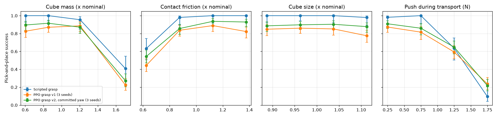

# Robustness (Milestone 6.1)

How does the full pick-and-place system (supervisor, grasp, scripted transport, scripted place; see [pick_and_place.md](pick_and_place.md)) hold up when the world differs from the one it was built in? Nothing was trained or tuned on these conditions.

## Protocol (`polypanda.evaluation.robustness`, `scripts/evaluate_robustness.py`)

Every condition reuses the 200 held-out pick-and-place scenes (`pickplace_nominal_v1`). Perturbations are drawn per scene from a dedicated SeedSequence stream (spawn key `0x8B0D`, seed 20261026), so they are reproducible and **identical for every grasp skill**, which makes the comparisons paired.

| Condition | What changes | Range |
|---|---|---|
| mass | cube mass (same size, different density) | × 0.5–2, log-uniform |
| friction | contact friction of the cube, finger pads and table, scaled together* | × 0.5–1.5 |
| size | all cube dimensions (constant density, so mass scales with volume) | × 0.85–1.15 |
| joints | arm start pose offset from home | ± 0.1 rad per joint |
| push | horizontal force on the cube during transport, random direction, 0.2 s | 0–2 N |
| combined | all of the above at once | as above |
| ood | cube starts in a 5 cm band **outside** the placement region (targets unchanged) | out of distribution |

\* MuJoCo combines the friction of two touching geoms with max(), so scaling only the cube would have no effect below nominal. A test checks that the nominal setting reproduces the original results exactly.

The push range is set by the gripper. It squeezes with about 1 N per finger, so friction can hold about 2 N, and the cube's weight already uses about 1 N of that. A first trial with pushes up to 4 N dislodged every cube, which measures nothing, so the range was narrowed to bracket the limit.

## Results

Success, with 95 % Wilson intervals. The PPO grasp row pools 3 seeds × 200 scenes. Evaluated at commit `d35408f` (clean); raw outputs in [`results/robustness/`](../results/robustness/).

| Condition | Scripted grasp | PPO grasp v1 (3 seeds) |
|---|---|---|
| nominal (no perturbation) | 100 % (98.1–100 %) | 86.0 % (83.0–88.5 %) |
| mass | 84.5 % (78.8–88.9 %) | 70.5 % (66.7–74.0 %) |
| friction | 88.5 % (83.3–92.2 %) | 72.7 % (69.0–76.1 %) |
| size | 99.5 % (97.2–99.9 %) | 83.5 % (80.3–86.3 %) |
| joints | 100 % (98.1–100 %) | 82.3 % (79.1–85.2 %) |
| push | 66.0 % (59.2–72.2 %) | 62.0 % (58.1–65.8 %) |
| combined | 55.5 % (48.6–62.2 %) | 45.3 % (41.4–49.3 %) |
| ood | 99.0 % (96.4–99.7 %) | 63.7 % (59.7–67.4 %) |

*Success by perturbation size (`scripts/summarize_robustness.py`). Bars are 95 % Wilson intervals.*

## What breaks, and where

- **The grip is the physical limit.** Cubes heavier than about 1.4× nominal (41 % success for the scripted chain), friction below about 0.75× (63 %) and pushes above about 1 N (64 % at 1–1.5 N, 10 % at 1.5–2 N) defeat both chains in the same way. The cube slips out of the fingers while it is carried. For the scripted chain, transport causes 17 of the 31 mass failures and 64 of the 68 push failures. A stronger grip or a different gripper would fix this; no grasp policy can.
- **Geometry and start pose are no problem for the scripted chain.** It handles ±15 % size, start-pose offsets and placements outside its usual region (99–100 %), because its IK plans from the measured cube pose.
- **The learned grasp does not extrapolate.** Placed just outside the region it was trained on, the cube is grasped far less often: 63.7 % success against 86.0 % nominal, with 201 of 600 episodes failing at the grasp stage. Within the region, size and start-pose changes cost only 2–4 points.
- **The learned grasp is also more sensitive to mass and friction at the grasp itself.** Grasp-stage failures rise from 77 (nominal, 600 episodes) to 111 with mass varied and 92 with friction varied. For the scripted grasp they go from 0 to 7 and 2. This finding is why grasp task v2 trains with randomized cube mass and friction ([grasp_task.md](grasp_task.md)).
- **Recovery still works under perturbation.** Episodes are recovered by re-grasping in every condition. The supervisor's labels (`cube tipped over`, `cube out of the workspace`, `out of attempts`) separate falls from failed grasps.

## Scope

These are simulation results for one cube and one gripper model. They show where this system fails and why. They say nothing about how a real Panda would behave.
