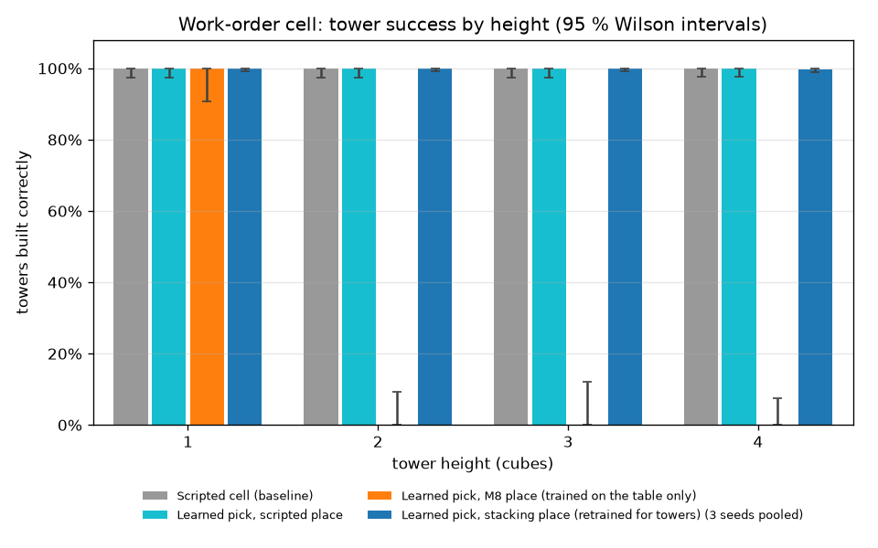

# The work-order cell (Milestone 9, in progress)

Milestones 1–8 picked one cube and placed it on an open table in front of the robot. Milestone 9 puts the learned skills to work in a small production cell. Cubes arrive on an infeed conveyor, and the robot builds three towers to a work order shown on signs, swinging its base between stations on every cycle.

**Status:**

| Part | State |
|---|---|
| Cell, work orders, conveyor feeding | done |
| Scripted cell controller (baseline) | done: 60/60 towers on 20 orders |
| Station frames (front-trained skills at any station) | done |
| Learned grasp at the infeed | done, without retraining: 4545/4545 picks |
| Learned place on towers | retrained for stack heights: 4544/4545 placements |
| **Learned skills vs scripted cell, 200 orders** | **done: 599/600 orders (3 seeds) vs 200/200** |
| Random arrival order with a buffer and planner (Layer 2) | approved, next |
| Heights 5–6 stress test (Layer 3) | later; needs a higher carry posture |

**Headline:** grasp and place policies trained with PPO run the whole work-order cell:
- the grasp transfers without retraining; the place was retrained with towers;
- the moves between stations are scripted;
- they complete **99.8 % of 600 held-out orders** (3 seeds, 1800 towers, 4545 cubes);
- the scripted cell completes 100 % of the same orders. The difference is one order and not significant (exact McNemar p = 1).
- The learned cell is slightly faster: 19.4–19.9 s of simulated time per cube, against 20.5 s scripted.

## The cell (`polypanda.simulation.workcell`)

| Station | Base angle | Contents |
|---|---|---|
| Infeed conveyor | +90° | an indexing belt brings one cube at a time to the pick point and stops |
| Towers A, B, C | −40°, −90°, −140° | fixtures with a recipe sign behind each: coloured squares, bottom to top |
| Reject bin | +150° | (for the later buffer and planner layer) |

All stations sit on a circle of 0.5 m radius around the base at table height. The skills were trained in front of the robot at that distance, so every station is the trained situation turned about the base axis.

- **Work orders** (`WorkOrder.random`): every episode draws a recipe per tower: a height of 1–4 cubes, four colours, repeats allowed. Cubes arrive in an always-placeable order: the next cube is always one that some tower needs next. With random arrival order a buffer and planner would be needed; that is a later layer.
- **Feeding:** up to 12 cubes per order wait in a hidden hopper and enter the belt in batches of 3 through a tunnel. The belt rewinds when it is empty. Each cube arrives with random jitter of ±1.5 cm sideways and ±15° yaw.
- **Gripper:** the finger servos are stiffer than Menagerie's (1000 N/m instead of 100 N/m), giving about 20 N of grip instead of about 2 N. A real Franka hand squeezes with up to 70 N. Results from Milestones 1–8 are for the original gripper.
- **Factory dressing:** epoxy floor, guarding, cabinet with stack light, hall. It is visual only and never collides with anything.

View it: `uv run python scripts/view_workcell.py` (`--static` shows the cell without running orders).

## Grasp assist: a disclosed simplification

**What it is.** When the cell's grasp check passes (both fingers pressing on the cube with at least 2 N), a weld constraint holds the cube in its current pose relative to the hand while it is carried. The weld is released before the fingers open, so the release and the placement are fully physical. Picking itself is unchanged: an unverified grip is never welded, so a missed or failed grasp still fails.

**Why.** In this simulation, a firmly held cube slides along the finger pads whenever the arm moves: about 17 mm during one lift, and out of the hand within a few long base swings. None of the following stopped it:
- grip force of 20, 40 or 60 N;
- slower swings, or other grip directions;
- torsional friction (kept), elliptic friction cones, impratio or contact softness;
- more solver iterations, noslip iterations, or finger damping;
- one wide pad per finger.

Real grippers do not lose a firmly gripped cube this way, so the effect is an artefact of the simulated contact. The weld stands in for a firm grip so that Milestone 9 can study the cell task rather than this artefact.

**What it means for the results.** Cell results measure grasping, placing and the coordination of the cell. They do not measure grip retention while carrying. Learned and scripted skills get exactly the same assist. It is a single switch, `WorkcellConfig.grasp_assist`, and the tests cover it on and off.

## The scripted cell controller (`polypanda.control.scripted_cell.ScriptedCell`)

This is the baseline that the learned skills are compared against. Each design rule fixed a failure measured in the first sketch:
- **One carry posture.** Cubes are carried at 0.32 m with a fixed arm shape. Every move between stations turns the base joint alone, so the hand stays level and no IK runs during a swing. Interpolating all joints over a 200° move tilts the hand mid-swing.
- **Base swings stay inside joint 1's ±166° range,** taking the way round that fits.
- **The wrist turns only at the infeed,** to match the cube's yaw, and turns back after the lift.
- **Vertical moves are short and closed-loop going down,** so arm sag never puts the grip or the stack off centre.

With the grasp assist it completed **60/60 towers on 20 orders**, heights 1–4, with jittered infeed, no drops and no IK failures, at swing rates of 0.5, 0.8 and 1.0 rad/s.

## Station frames (`polypanda.supervisor.stations.StationView`)

The cell is symmetric about the robot's base axis. Rotating the whole scene by an angle θ is the same as adding θ to joint 1. So a policy trained with its work in front of the robot can work at a station at angle θ, as long as it sees the scene rotated back by −θ and its hand motions are rotated forward by +θ:
- **observations:** world vectors (positions, offsets, the hand's rotation, the cube's up axis) turn by −θ, and joint 1 (measured and commanded) is reduced by θ;
- **actions:** the hand-motion adapter reads them in the station frame (`CartesianActionAdapter.set_frame`), including its workspace box and the IK's preferred posture.

**Test** (`tests/test_stations.py`): a scene rotated by 90°, −40° and −140°, seen through the view, gives the same observations and the same response to the same actions as the original, within 2 mm after 40 steps. The one exception is the held cube's tilt under tilting actions, which drifts by a few milliradians, because MuJoCo's friction cones are not exactly rotation-invariant.

## Learned skills in the cell (`polypanda.supervisor.cell.LearnedCell`)

`LearnedCell` is the scripted cell controller with its pick and/or place replaced by trained policies; the swings between stations stay scripted.
- **Learned pick:** the arm starts in its home pose turned to face the infeed, as in training. The policy runs until its own success check holds: a verified grasp with the cube 5 cm up. Then the grasp assist engages and the arm rises to the carry posture.
- **Learned place:** a scripted descent brings the cube to where place episodes start in training, 9 cm above the top of the stack. The policy then sets it down. The assist is released the moment the policy's gate opens the fingers.

### Results: 200 held-out work orders

All configurations get the same 200 orders: heights 1–4, 1515 cubes, ±1.5 cm / ±15° infeed jitter. They were produced by `scripts/evaluate_cell.py` and are stored in [`results/cell/`](../results/cell/).

| Pick | Place | Orders complete | Towers correct | Learned skill success | Simulated time per cube |
|---|---|---|---|---|---|
| scripted | scripted | **200/200** (95 % CI 98.1–100 %) | 600/600 | n/a | 20.5 s |
| PPO grasp (seed 1) | scripted | **200/200** | 600/600 | picks 1515/1515 | 20.2 s |
| PPO grasp (seed 0) | PPO stacking place (seed 0) | **200/200** | 600/600 | picks 1515/1515, places 1514/1515 | 19.5 s |
| PPO grasp (seed 1) | PPO stacking place (seed 1) | **199/200** | 599/600 | picks 1515/1515, places 1515/1515 | 19.4 s |
| PPO grasp (seed 2) | PPO stacking place (seed 2) | **200/200** | 600/600 | picks 1515/1515, places 1515/1515 | 19.9 s |
| **Fully learned, 3 seeds pooled** | | **599/600 = 99.8 %** (99.1–100 %) | 1799/1800 | picks 100 %, places 99.98 % | |



*Tower success by tower height on the same orders (95 % Wilson intervals; `scripts/plot_cell_heights.py`). The orange series is the Milestone 8 place policy, trained only on the table, on the first 50 of the orders. It builds every 1-high tower, but none taller.*

- **Learned grasp:** these are the Milestone 8 hand-motion policies, unchanged, and a pick takes a median of 60–67 policy steps (about 3 s). They were trained on a plain table in front of the robot. Through the station frame they transfer without retraining to a conveyor 90° to the side, a stiffer gripper and a 2 mm higher surface.
- **Learned place:** a median of 22 steps (about 1 s) per cube.
  - Seed 0's one unsuccessful placement was a timeout (the policy's own placed check did not hold within its horizon). The cube still ended correctly on its tower.
- **Paired with the scripted cell,** order by order, the only discordant order is seed 1's order 79 (exact McNemar p = 1).

**The one failure (seed 1, order 79, tower C of a 4-4-4 order)** was replayed and traced (the cell is deterministic):
1. While setting the 4th cube on tower C, the place policy nudged the stack below by about 3 mm. That placement took 29 policy steps, against a median of 22. The placed cube itself landed 0.7 mm from centre, and the skill's own checks passed.
2. No part of the robot touched the tower again. Even so, the slightly offset stack crept sideways on its own, at 0.08 mm/s rising to 0.5 mm/s. Over the next 2 minutes of simulated time its top drifted 22 mm, past the check's 20 mm.

Part 2 is a simulator effect: MuJoCo's soft contacts let an offset stack creep. A real stack offset by a few millimetres is statically stable, with its centre of mass well inside the 4 cm footprint. Part 1 is real, though: the scripted place never nudges the stack. So the order is counted as a learned-chain failure.

**Learned place on towers: why it had to be retrained.** The Milestone 8 place policy was trained only to set cubes down on the table. Unchanged, it fails on taller towers. These are development runs, and levels count from the table, so a cube placed at level 3 lands on a 2-cube tower:

| Placed at level | In the cell | Training scene, 20 tries per level |
|---|---|---|
| 1 (on the table) | 12/12 | 20/20 |
| 2 | 12/12 | 17/20 |
| 3 | 0/10 | 11/20 |
| 4 | 1/5 | 1/20 |
| 5 | n/a | 0/20 |
| 6 | n/a | 0/20 |

Most failures knock the tower over. On the first 50 evaluation orders, the learned grasp with this unchanged place completes 1 order. It builds 38/38 one-high towers and 0 of 112 taller ones: every cube set onto another cube toppled. (With learned grasps, even level 2 fails; in the development check above with scripted grasps it held.) The retrained place adds towers to the place task (`PlaceConfig.stack`, `configs/place_stack_cartesian.yaml`):
- each episode sets the cube on a tower of 0–5 cubes at the target;
- it starts from the same handoff states, raised by IK by the tower's height (hand and cube together, so the grip is unchanged);
- moving a tower cube by more than 1 cm ends the episode as a failure.

Three seeds were trained with PPO for 2M steps each, about 2 h in parallel on CPU. Their best validation success over towers of 0–5 cubes was 93 %, 96 % and 93 %, against 41 % (49 of 120 development episodes, table above) for the Milestone 8 place on the same mix. The best checkpoint was selected on a separate validation stream, as for every earlier skill. In the cell (heights 1–4) they placed 4544 of 4545 cubes.

## Evaluating the cell

```bash
uv run python scripts/evaluate_cell.py                                    # scripted cell
uv run python scripts/evaluate_cell.py --pick run:runs/grasp_cart_seed0   # learned pick
uv run python scripts/evaluate_cell.py --pick run:runs/<grasp> --place run:runs/<place>
uv run python scripts/evaluate_cell.py ... --compare results/cell/<other>_episodes.csv
```

Each order *i* comes from its own random stream, which also draws the infeed jitter. So every configuration sees exactly the same 200 orders, and configurations are compared order by order (exact McNemar test). An order counts only if every tower is complete and correct: each cube upright, at its level, within 2 cm of the fixture and in recipe order. Failures are attributed to the first failing learned skill, the conveyor, or the final tower check.
