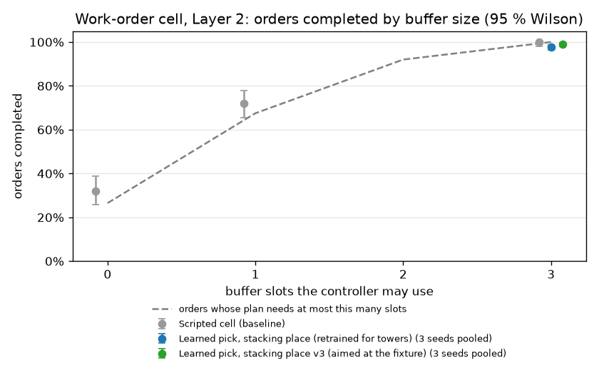

# The work-order cell (Milestone 9, in progress)

Milestones 1–8 picked one cube and placed it on an open table in front of the robot. Milestone 9 puts the learned skills to work in a small production cell. Cubes arrive on an infeed conveyor, and the robot builds three towers to a work order shown on signs, swinging its base between stations on every cycle.

**Status:**

| Part | State |
|---|---|
| Cell, work orders, conveyor feeding | done |
| Scripted cell controller (baseline) | done: 60/60 towers on 20 orders |
| Station frames (front-trained skills at any station) | done |
| Learned grasp at the infeed | done, without retraining: 4545/4545 picks |
| Learned place on towers | retrained for stack heights: 4544/4545 placements |
| **Learned skills vs scripted cell, 200 orders** | **done: 599/600 orders (3 seeds) vs 200/200** |
| Random arrival order with a buffer and planner (Layer 2) | **done: 595/600 orders learned (3 seeds) vs 200/200 scripted** |
| Gentler, more precise stacking place (v2, v3) and a root-cause analysis | done: v3, aimed at the fixture |
| Heights 5–6 stress test (Layer 3) | later; needs a higher carry posture |

**Headline:** grasp and place policies trained with PPO run the whole work-order cell:
- the grasp transfers without retraining; the place was retrained with towers;
- the moves between stations are scripted;
- they complete **99.8 % of 600 held-out orders** (3 seeds, 1800 towers, 4545 cubes);
- the scripted cell completes 100 % of the same orders. The difference is one order and not significant (exact McNemar p = 1).
- The learned cell is slightly faster: 19.4–19.9 s of simulated time per cube, against 20.5 s scripted.

**Layer 2** (cubes in random order, with surplus cubes, a three-slot buffer and a planner):
- the scripted greedy planner routes each cube; the learned grasp and place do every pick and placement, including those into and out of the buffer;
- they complete **99.2 % of 600 held-out orders** (595/600, 3 seeds) with the v3 stacking place aimed at the fixture, and 97.8 % (587/600) with v1;
- the scripted cell completes 200/200. Every learned failure is on a 4-high tower. The ones replayed began with a placement a few millimetres off, after which the stack crept out of tolerance or fell, a simulator effect ([v3 in the cell](#v3-in-the-cell-a-root-cause-analysis));
- the v3 place came out of a root-cause analysis. Aimed at the cube below, as it was trained, it failed 12 % of the Layer 1 and 31 % of the Layer 2 orders before those evaluations were stopped. Aimed at the fixture, it is the best place policy so far.

## The cell (`polypanda.simulation.workcell`)

| Station | Base angle | Contents |
|---|---|---|
| Infeed conveyor | +90° | an indexing belt brings one cube at a time to the pick point and stops |
| Towers A, B, C | −40°, −90°, −140° | fixtures with a recipe sign behind each: coloured squares, bottom to top |
| Buffer slots 0, 1, 2 | −10°, +10°, +30° | Layer 2: places to park a cube that a tower needs later |
| Reject bin | +150° | Layer 2: for cubes no tower needs |

All stations sit on a circle of 0.5 m radius around the base at table height. The skills were trained in front of the robot at that distance, so every station is the trained situation turned about the base axis.

- **Work orders** (`WorkOrder.random`): every episode draws a recipe per tower: a height of 1–4 cubes, four colours, repeats allowed. In Layer 1, cubes arrive in an always-placeable order: the next cube is always one that some tower needs next. Layer 2 drops that ([below](#layer-2-random-arrivals-a-buffer-and-a-planner)).
- **Feeding:** up to 12 cubes per order wait in a hidden hopper and enter the belt in batches of 3 through a tunnel. The belt rewinds when it is empty. Each cube arrives with random jitter of ±1.5 cm sideways and ±15° yaw.
- **Gripper:** the finger servos are stiffer than Menagerie's (1000 N/m instead of 100 N/m), giving about 20 N of grip instead of about 2 N. A real Franka hand squeezes with up to 70 N. Results from Milestones 1–8 are for the original gripper.
- **Factory dressing:** epoxy floor, guarding, cabinet with stack light, hall. It is visual only and never collides with anything.

View it: `uv run python scripts/view_workcell.py` (`--static` shows the cell without running orders).

## Grasp assist: a disclosed simplification

**What it is.** When the cell's grasp check passes (both fingers pressing on the cube with at least 2 N), a weld constraint holds the cube in its current pose relative to the hand while it is carried. The weld is released before the fingers open, so the release and the placement are fully physical. Picking itself is unchanged: an unverified grip is never welded, so a missed or failed grasp still fails.

**Why.** In this simulation, a firmly held cube slides along the finger pads whenever the arm moves: about 17 mm during one lift, and out of the hand within a few long base swings. None of the following stopped it:
- grip force of 20, 40 or 60 N;
- slower swings, or other grip directions;
- torsional friction (kept), elliptic friction cones, impratio or contact softness;
- more solver iterations, noslip iterations, or finger damping;
- one wide pad per finger.

Real grippers do not lose a firmly gripped cube this way, so the effect is an artefact of the simulated contact. The weld stands in for a firm grip so that Milestone 9 can study the cell task rather than this artefact.

**What it means for the results.** Cell results measure grasping, placing and the coordination of the cell. They do not measure grip retention while carrying. Learned and scripted skills get exactly the same assist. It is a single switch, `WorkcellConfig.grasp_assist`, and the tests cover it on and off.

## The scripted cell controller (`polypanda.control.scripted_cell.ScriptedCell`)

This is the baseline that the learned skills are compared against. Each design rule fixed a failure measured in the first sketch:
- **One carry posture.** Cubes are carried at 0.32 m with a fixed arm shape. Every move between stations turns the base joint alone, so the hand stays level and no IK runs during a swing. Interpolating all joints over a 200° move tilts the hand mid-swing.
- **Base swings stay inside joint 1's ±166° range,** taking the way round that fits.
- **The wrist turns only at the infeed,** to match the cube's yaw, and turns back after the lift.
- **Vertical moves are short and closed-loop going down,** so arm sag never puts the grip or the stack off centre.

With the grasp assist it completed **60/60 towers on 20 orders**, heights 1–4, with jittered infeed, no drops and no IK failures, at swing rates of 0.5, 0.8 and 1.0 rad/s.

## Station frames (`polypanda.supervisor.stations.StationView`)

The cell is symmetric about the robot's base axis. Rotating the whole scene by an angle θ is the same as adding θ to joint 1. So a policy trained with its work in front of the robot can work at a station at angle θ, as long as it sees the scene rotated back by −θ and its hand motions are rotated forward by +θ:
- **observations:** world vectors (positions, offsets, the hand's rotation, the cube's up axis) turn by −θ, and joint 1 (measured and commanded) is reduced by θ;
- **actions:** the hand-motion adapter reads them in the station frame (`CartesianActionAdapter.set_frame`), including its workspace box and the IK's preferred posture.

**Test** (`tests/test_stations.py`): a scene rotated by 90°, −40° and −140°, seen through the view, gives the same observations and the same response to the same actions as the original, within 2 mm after 40 steps. The one exception is the held cube's tilt under tilting actions, which drifts by a few milliradians, because MuJoCo's friction cones are not exactly rotation-invariant.

## Learned skills in the cell (`polypanda.supervisor.cell.LearnedCell`)

`LearnedCell` is the scripted cell controller with its pick and/or place replaced by trained policies; the swings between stations stay scripted.
- **Learned pick:** the arm starts in its home pose turned to face the infeed, as in training. The policy runs until its own success check holds: a verified grasp with the cube 5 cm up. Then the grasp assist engages and the arm rises to the carry posture.
- **Learned place:** a scripted descent brings the cube to where place episodes start in training, 9 cm above the top of the stack. The policy then sets it down. The assist is released the moment the policy's gate opens the fingers. Its target is the fixture centre (for why not the cube below, see [v3](#v3-in-the-cell-a-root-cause-analysis)).

### Results: 200 held-out work orders (Layer 1)

All configurations get the same 200 orders: heights 1–4, 1515 cubes, ±1.5 cm / ±15° infeed jitter. They were produced by `scripts/evaluate_cell.py` and are stored in [`results/cell/`](../results/cell/).

| Pick | Place | Orders complete | Towers correct | Learned skill success | Simulated time per cube |
|---|---|---|---|---|---|
| scripted | scripted | **200/200** (95 % CI 98.1–100 %) | 600/600 | n/a | 20.5 s |
| PPO grasp (seed 1) | scripted | **200/200** | 600/600 | picks 1515/1515 | 20.2 s |
| PPO grasp (seed 0) | PPO stacking place (seed 0) | **200/200** | 600/600 | picks 1515/1515, places 1514/1515 | 19.5 s |
| PPO grasp (seed 1) | PPO stacking place (seed 1) | **199/200** | 599/600 | picks 1515/1515, places 1515/1515 | 19.4 s |
| PPO grasp (seed 2) | PPO stacking place (seed 2) | **200/200** | 600/600 | picks 1515/1515, places 1515/1515 | 19.9 s |
| **Fully learned, 3 seeds pooled** | | **599/600 = 99.8 %** (99.1–100 %) | 1799/1800 | picks 100 %, places 99.98 % | |
| PPO grasp (seeds 0, 1, 2) | PPO stacking place v3, aimed at the fixture | **199, 200, 200** | 1799/1800 | picks 4545/4545, places 4543/4545 | 19.1–19.8 s |
| **v3, 3 seeds pooled** | | **599/600 = 99.8 %** (99.1–100 %) | | | |


*Tower success by tower height on the same orders (95 % Wilson intervals; `scripts/plot_cell_heights.py`). The orange series is the Milestone 8 place policy, trained only on the table, on the first 50 of the orders. It builds every 1-high tower, but none taller. The stacking place v1 (blue) and v3 aimed at the fixture (green) build the same number of towers at every height.*

- **Learned grasp:** these are the Milestone 8 hand-motion policies, unchanged, and a pick takes a median of 60–67 policy steps (about 3 s). They were trained on a plain table in front of the robot. Through the station frame they transfer without retraining to a conveyor 90° to the side, a stiffer gripper and a 2 mm higher surface.
- **Learned place:** a median of 22 steps (about 1 s) per cube.
  - Seed 0's one unsuccessful placement was a timeout (the policy's own placed check did not hold within its horizon). The cube still ended correctly on its tower.
- **Paired with the scripted cell,** order by order, the only discordant order is seed 1's order 79 (exact McNemar p = 1).

**The one failure (seed 1, order 79, tower C of a 4-4-4 order)** was replayed and traced (the cell is deterministic):
1. While setting the 4th cube on tower C, the place policy nudged the stack below by about 3 mm. That placement took 29 policy steps, against a median of 22. The placed cube itself landed 0.7 mm from centre, and the skill's own checks passed.
2. No part of the robot touched the tower again. Even so, the slightly offset stack crept sideways on its own, at 0.08 mm/s rising to 0.5 mm/s. Over the next 2 minutes of simulated time its top drifted 22 mm, past the check's 20 mm.

Part 2 is a simulator effect: MuJoCo's soft contacts let an offset stack creep. A real stack offset by a few millimetres is statically stable, with its centre of mass well inside the 4 cm footprint. Part 1 is real, though: the scripted place never nudges the stack. So the order is counted as a learned-chain failure.

**Learned place on towers: why it had to be retrained.** The Milestone 8 place policy was trained only to set cubes down on the table. Unchanged, it fails on taller towers. These are development runs, and levels count from the table, so a cube placed at level 3 lands on a 2-cube tower:

| Placed at level | In the cell | Training scene, 20 tries per level |
|---|---|---|
| 1 (on the table) | 12/12 | 20/20 |
| 2 | 12/12 | 17/20 |
| 3 | 0/10 | 11/20 |
| 4 | 1/5 | 1/20 |
| 5 | n/a | 0/20 |
| 6 | n/a | 0/20 |

Most failures knock the tower over. On the first 50 evaluation orders, the learned grasp with this unchanged place completes 1 order. It builds 38/38 one-high towers and 0 of 112 taller ones: every cube set onto another cube toppled. (With learned grasps, even level 2 fails; in the development check above with scripted grasps it held.) The retrained place adds towers to the place task (`PlaceConfig.stack`, `configs/place_stack_cartesian.yaml`):
- each episode sets the cube on a tower of 0–5 cubes at the target;
- it starts from the same handoff states, raised by IK by the tower's height (hand and cube together, so the grip is unchanged);
- moving a tower cube by more than 1 cm ends the episode as a failure.

Three seeds were trained with PPO for 2M steps each, about 2 h in parallel on CPU. Their best validation success over towers of 0–5 cubes was 93 %, 96 % and 93 %, against 41 % (49 of 120 development episodes, table above) for the Milestone 8 place on the same mix. The best checkpoint was selected on a separate validation stream, as for every earlier skill. In the cell (heights 1–4) they placed 4544 of 4545 cubes. This is stacking place v1; [v2 and v3](#improving-the-stacking-place-v2-v3) below try to make it gentler.

## Layer 2: random arrivals, a buffer and a planner

Layer 1 fed cubes in an order that always fits. In Layer 2 the cubes arrive in random order, with 0–2 surplus cubes per order that no tower needs, so the cell has to decide where each cube goes.

- **Stations:** three buffer slots between tower A and the infeed (−10°, +10°, +30°), and a reject bin at +150°.
- **Planner** (`polypanda.supervisor.planner.GreedyPlanner`). Each arriving cube goes, in this order of preference:
  1. to a tower whose next cube is this colour;
  2. into a free buffer slot, if a tower still needs this colour later;
  3. into the reject bin.

  After every tower placement, buffered cubes that have become placeable move to their towers. The planner follows the plan, not the physics: a physical failure shows up in the final tower check.
- **Orders** (`mixed_order`): the same recipes as Layer 1 plus the surplus cubes, shuffled. A shuffle the plan cannot complete with 3 slots is redrawn. Of the 200 evaluation orders, the plan needs no slot for 27 %, at most one for 68 % and at most two for 92 %.
- **More learned work per order:** a parked cube is picked and placed twice. Per seed, the 200 orders bring 1734 cubes. 1515 end on towers, 219 surplus cubes go to the reject bin, and 276 are parked on the way. So the learned skills make 2010 picks and 1791 placements (276 of them into the buffer). Dropping a cube into the reject bin is scripted.
- **A layout bug found on the way:** a first layout had a slot at +60°, where a parked cube overhung the belt and was dragged along by it. The evaluations reported cubes that "did not arrive". The slots were moved, a test now checks that parked cubes clear the belt, and those evaluations were discarded.

### Results: 200 held-out Layer 2 orders

Every configuration gets the same 200 orders (`--mixed`).

| Pick | Place | Buffer slots | Orders complete | Failures | Simulated time per cube |
|---|---|---|---|---|---|
| scripted | scripted | 0 | 64/200 (32 %) | buffer full: 136 | 19.0 s |
| scripted | scripted | 1 | 144/200 (72 %) | buffer full: 56 | 21.0 s |
| scripted | scripted | 3 | **200/200** (98.1–100 %) | none | 21.9 s |
| PPO grasp | PPO stacking place v1, seeds 0, 1, 2 | 3 | 197, 190, 200 of 200 | tower: 3, 10, 0 | 20.9, 20.7, 21.3 s |
| **v1, 3 seeds pooled** | | 3 | **587/600 = 97.8 %** (96.3–98.7 %) | tower: 13 | |
| PPO grasp | PPO stacking place v3, aimed at the fixture, seeds 0, 1, 2 | 3 | 196, 199, 200 of 200 | tower: 3, 1, 0; place toppled: 1, 0, 0 | 20.5, 21.0, 21.2 s |
| **v3, 3 seeds pooled** | | 3 | **595/600 = 99.2 %** (98.1–99.6 %) | tower: 4, place toppled: 1 | |



*Orders completed against buffer slots (95 % Wilson intervals; `scripts/plot_cell_buffer.py`). The dashed line is the share of orders whose plan never needs more than that many slots. With fewer slots the scripted cell fails only by running out of buffer. It does a little better than the line, because a later surplus cube can stand in for a needed cube that had to be rejected.*

- **The buffer is what makes Layer 2 work:** without it the scripted cell completes a third of the orders, with one slot 72 %, with three all of them.
- **Learned skills, v1 place:** all 2010 picks and 1791 placements per seed succeeded by their own checks. Every one of the 13 failed orders was a 4-high tower that failed the final check. The mechanism is the one traced in Layer 1: a placement nudges the stack by a few millimetres, and the offset stack then creeps in the simulator until it is out of tolerance or falls. Layer 2 orders take longer (parking and rejecting), so finished towers stand, and creep, for longer. That is the likely reason for 13 failures here against 1 in Layer 1, on the same recipes; it has not been verified.
- **Learned skills, v3 place aimed at the fixture:** 5 failed orders against v1's 13. On the same orders and seeds, v3 completes 11 orders that v1 fails and v1 completes 3 that v3 fails (exact McNemar p = 0.057). That is fewer failures, but not a significant difference at the 5 % level. All of the improvement is seed 1 (199 against 190). Seed 0 has 4 of v3's 5 failures; it is also the v3 seed that nudges towers most in the probe below.

## Improving the stacking place: v2, v3

v1's failures need a nudge and the simulator's creep. Two retrains tried to remove the nudge. Both are kept as configurations, and the results below are from the same evaluations as above.

**Probe in the training scene** (`scripts/probe_place_stack.py`; 40 episodes per tower height, fixed seeds; ranges over 3 seeds):

| | v1 | v2 | v3 |
|---|---|---|---|
| Cube off centre on the table (median) | 5.7–8.4 mm | 5.5–7.1 mm | 3.3–6.0 mm |
| the same, 90th percentile | 12.3–16.8 mm | 18.1–21.1 mm | 7.0–14.2 mm |
| Cube off the cube below, on a 1-cube tower (median) | 4.3–7.9 mm | 6.1–7.5 mm | 2.7–4.2 mm |
| Cube off the cube below, on a 3-cube tower (median) | 4.8–6.2 mm | 5.4–6.9 mm | 2.8–3.8 mm |
| Placements moving a 3-cube tower by over 2 mm | 35–42 % | 20–45 % | 25–57 % |

What makes a tower creep is how far each cube overhangs the one below it. In the cell, that is the difference between the errors at consecutive levels.

### v2: penalise every nudge

`configs/place_stack_v2_cartesian.yaml` charges every millimetre a tower cube moves (1000 per metre) and fails the episode at 5 mm instead of 1 cm.
- **In the training scene** the policies did not become clearly gentler (table above). Their median precision stayed close to v1's, but their worst placements were further off.
- **In the cell,** 8 of the first 30 Layer 1 orders and 7 of the first 21 Layer 2 orders failed, and the evaluations were stopped.
- **Why,** from a later replay of order 1 with `scripts/diagnose_cell_order.py`: two of the three v2 policies set the first cube on the table 9–16 mm off the fixture, then the cubes on top 4–8 mm off it in another direction. The second cube overhung the first by 3–10 mm, and the overhang crept until a tower fell. In the same order v1's cubes overhang each other by at most about 3.5 mm.

**Lesson:** the penalty did not buy gentleness, and it made the large errors larger.

### v3: reward precision as well

`configs/place_stack_v3_cartesian.yaml`:
- a bonus of 0.5 per step with the cube placed within 1 cm (placed still means within 2 cm);
- a softer nudge charge (300 per metre, failing at 1 cm as in v1);
- the target is the top tower cube's actual position, not the fixture, so each cube is centred on what it stands on.

Three earlier v3 attempts never learned: about 0 % validation after 0.3–0.5M steps. All three charged a cost per step for the cube's distance from the target after release. That cost is unbounded. A clumsy release 10 cm away costs 2 per step for the rest of the episode, more than losing the cube (−5, which ends the episode). The policies learned to lose the cube. Without that cost, the three seeds reached 98 %, 98 % and 99 % best validation. (The attempts also tried a 1 cm release gate and a 1 cm placed check, one at a time. Those changes are confounded with the cost, so nothing is concluded about them.) **Lesson:** a shaping cost must stay smaller than the failure it is meant to avoid.

In the training scene v3 is the most precise of the three (table above). It nudges a 3-cube tower about as often as v1, more for seed 0 and less for seed 2.

### v3 in the cell: a root-cause analysis

As trained, aimed at the cube below, v3 was far worse than v1 in the cell. 20 of the first 165 Layer 1 orders failed, and 38 of the first 124 Layer 2 orders. Those evaluations were stopped. Replays with `scripts/diagnose_cell_order.py`, which logs every placement and films the towers, traced the failures to a chain of three causes:

1. **A repeatable error.** In the cell every placement starts from almost the same state: the same carry posture, the same descent, the cube centred over the target. A deterministic policy then makes almost the same error every time (this holds for v1 and v2 too). For seed 2 it was 1.5 mm outward and 3 mm to the right, within ±1 mm on all 12 placements of an order. Seed 0 and seed 1 err by a similar amount in other directions. In the training scene each policy has a similar 1–3 mm average offset, but it is hidden in ±2–3 mm of scatter from varied starts.
2. **Aiming at the cube below adds the errors up.** Each level repeats the same offset, so the tower becomes a staircase. In order 1 for seed 2, tower B's cubes ended 3, 10, 18 and 22 mm off the fixture, past the check's 20 mm.
3. **Creep slides the staircase further.** In order 4, tower A's top cube was 12 mm off when placed. With no contact, it then slid to 47 mm over 80 s of simulated time and toppled, while the arm was working at tower C.

Training validation could not show this: every episode is one placement on a freshly built, centred tower, and the errors never accumulate.

**Fix: aim every cube at the fixture** (`LearnedCell(aim="fixture")`, the cell's default; `--aim trained` restores the trained target). Each cube's error then starts afresh from the fixture instead of adding to the one below. The v3 policies are unchanged; no retraining.

| Same 200 orders, 3 seeds | v1 | v3 aimed at the cube below (as trained) | v3 aimed at the fixture |
|---|---|---|---|
| Layer 1 | 599/600 | 20 of the first 165 failed (stopped) | **599/600** (McNemar p = 1 against v1) |
| Layer 2 | 587/600 | 38 of the first 124 failed (stopped) | **595/600** (p = 0.057 against v1) |

**What still fails.** Order 59 of Layer 2 (three 4-high towers) fails for seeds 0 and 1, and both were replayed with the diagnosis tool. In both, the first cube landed 6–8 mm off the fixture on the table, where v3 is least precise. The second cube, aimed at the fixture, overhung it by 4–9 mm. That overhang crept for 2–4 minutes of simulated time; then the tower fell on its own (seed 1, with the arm at another station) or toppled during the 4th placement (seed 0). The other failures (seed 0: Layer 2 orders 98, 186 and 197, Layer 1 order 118, all on 4-high towers) were not replayed.

**Lesson:** a skill's validation score covers the situation it was validated in. Chained, a deterministic policy fed near-identical starts turns its scatter into a fixed bias. Where the supervisor aims the skill decides whether that bias adds up.

## Evaluating the cell

```bash
uv run python scripts/evaluate_cell.py                                    # scripted cell
uv run python scripts/evaluate_cell.py --pick run:runs/grasp_cart_seed0   # learned pick
uv run python scripts/evaluate_cell.py --pick run:runs/<grasp> --place run:runs/<place>
uv run python scripts/evaluate_cell.py ... --compare results/cell/<other>_episodes.csv
uv run python scripts/evaluate_cell.py ... --mixed [--slots 3]          # Layer 2
uv run python scripts/evaluate_cell.py ... --aim trained                # v3 aimed at the cube below
uv run python scripts/diagnose_cell_order.py --pick ... --place ... --index 59 --mixed \
    --watch A --footage out/o59                                         # replay one order
uv run python scripts/probe_place_stack.py --place runs/<place run>     # training-scene probe
uv run python scripts/plot_cell_heights.py; uv run python scripts/plot_cell_buffer.py
```

Each order *i* comes from its own random stream, which also draws the infeed jitter. So every configuration sees exactly the same 200 orders, and configurations are compared order by order (exact McNemar test). An order counts only if every tower is complete and correct: each cube upright, at its level, within 2 cm of the fixture and in recipe order. Failures are attributed to the first failing learned skill, the planner (a needed cube rejected because the buffer was full), the conveyor, or the final tower check.
